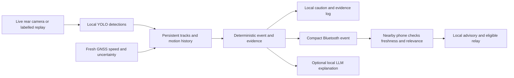

# Automatic cooperative perception in RoadMesh

RoadMesh 0.5.0 uses a phone mounted inside a vehicle, with its rear camera facing through the windscreen, as a local sensing node. YOLO detects visible objects; a bounded temporal evaluator associates objects across frames and creates event candidates. Participating phones automatically exchange compact warnings over Bluetooth and interpret received information locally. Starting a drive is the setup action. Reporting each incident is not part of the flow.

The same application retains recorded-video playback for a repeatable pitch. Live camera, recorded video, synthetic algorithm fixtures and the 3D scene have different provenance and must be described separately.

## Processing on every participating phone



Each phone has its own view. There is no requirement for one permanently designated camera leader in ROAD mode, and no laptop coordinates live event decisions. The visual track ID is a short-lived association within one camera session. It is not a number plate, authenticated vehicle identity or cross-camera re-identification.

Camera frames stay on the originating phone. The compact event includes hazard type, source identity, original generation time, provenance and available contextual detail. Bluetooth sends short event and presence messages, not continuous video. Local voice/haptics and deterministic decisions do not wait for Gemma text generation. Generated explanations are held until complete and checked before display or speech; event explanations expire after six seconds. This limits stale or unsupported wording without making the language model a driving authority.

## Starting live sensing

1. Install the same preview APK on each participating phone. Select the vehicle type during onboarding.
2. While parked, mount the phone securely with the rear camera facing the road and an unobstructed lens. Landscape mounting provides a wider road view; preview orientation is handled without globally locking the app. This does not calibrate distance estimates.
3. Open **Drive → Start drive** and grant camera, Bluetooth and precise-location permissions. This selects ROAD mode.
4. Inspect the live rear-camera label, actual boxes, track IDs, inference duration and analysis rate. The automatic pipeline card distinguishes camera capture, perception, event evaluation and local Bluetooth activity.
5. Keep the app in the foreground. Inspecting Mesh, Road, Lab or Events keeps the live camera surface attached. Backgrounding the app pauses camera analysis and invalidates in-flight results; returning resumes with fresh history.
6. Use **Stop drive** to stop sensing and the mesh session.

A phone can still show and speak a local camera caution before Bluetooth or a usable position is ready. It cannot claim a remotely received warning merely because it queued one. ROAD mode requires a real fresh position for event publication and does not substitute stage coordinates. GNSS quality can also prevent speed-dependent event classification.

The Bluetooth foreground service can continue receiving and relaying when the activity is backgrounded, subject to Android and device restrictions. Camera observation does not continue in that state. A phone accelerometer jolt is logged as an impact candidate; a dropped or bumped phone does not automatically broadcast a confirmed accident.

## What the temporal evaluator can infer

`AutomatedTrafficAnalyzer` runs after YOLO. Defaults bound it to 48 active tracks, 256 input detections and 32 samples per track, with a 2.5-second history. Matching, minimum history, persistence, heading consistency, uncertainty checks and cooldowns prevent a single detection from automatically becoming a new broadcast every frame.

| Event | Required evidence | Meaning of the output |
| --- | --- | --- |
| Relative approach | A persistently growing matched vehicle box with consistent motion | An approach candidate; it does not prove the other vehicle is braking |
| Host hard braking | Fresh timestamped host speed samples with acceptable accuracy and a conservative deceleration/drop threshold | This phone's vehicle appears to be braking sharply |
| Corroborated traffic slowdown | Valid host speed reduction plus at least two persistent vehicle tracks whose relative gaps are not opening | A local slowdown candidate supported by several visual tracks and host motion |
| Visible road hazard | Supported model class and temporal evidence, subject to the core rules | A prototype camera candidate, not a verified incident or violation |

Default speed uncertainty is limited to 1 m/s. The evaluator requires enough elapsed observation time and unique measurements; copying one GNSS speed value into many frames does not create multiple speed samples. A sharp camera turn, stale frame, repeated frame, discontinuous time or insufficient motion evidence suppresses the corresponding claim or resets history. Preview resize or rotation also changes the geometry epoch and resets history, so boxes from incompatible screen coordinates cannot accumulate motion evidence.

Apparent box growth depends on object size, perspective, camera motion and association quality. Distance and optical approach values remain estimates. The prototype does not recover reliable absolute speeds for every visible vehicle or guarantee that every vehicle and obstacle is detected.

The event record exposes its supporting evidence. On Drive, open **Inspect temporal evidence** beneath an automatic event. **Candidate queued** means accepted for mesh processing; position, freshness or rate checks can still reject it. A local `tx_complete` records a completed broadcast request. Receiver-side logs establish whether another phone actually received the event.

## Recorded clips for the pitch

From Drive, select **Open replay lab**, choose a clip and press **Start replay demo**. This selects STAGE mode and uses the same local YOLO and temporal evaluator on recorded frames. Keep the source label visible when presenting.

The retained bundled choices are:

| Clip | Purpose and attribution |
| --- | --- |
| C V Raman Road, Bengaluru | Dashcam traffic visualization, CC0 |
| Traffic through potholes | Roadside pothole footage, Amuzujoe, CC BY-SA 4.0 |
| Rain-filled potholes | Roadside pothole footage, Knowledge and philosophy, CC BY-SA 4.0 |

**Choose a recorded video** accepts another local clip. **Open 3D brake scene** retains the earlier synthetic vehicle scene. Both are demonstration inputs, not live camera evidence. The asset attribution remains in [ATTRIBUTION.md](../ATTRIBUTION.md).

Replay footage has no measured host GNSS speed attached. Therefore a clip alone must not be presented as proof of the host-braking or speed-corroborated slowdown path. Use its real detections and motion visualization, then show the synthetic event Lab to explain and exercise the additional sensor requirements. A quiet clip or insufficient evidence can legitimately produce no event.

### Three phones indoors

Start the source phone's replay first. For the two forwarding/receiving phones, select STAGE under Mesh settings and use **Start mesh**; their cameras are optional for this demonstration. The stage orders participants by their session start and applies the disclosed adjacency acceptance filter, so A → B → C is an intentional rehearsal topology even if all phones are physically within range.

Show an automatically generated clip event when one occurs, then verify its identity in the receiving phone's Mesh/Road view or exported logs. A replay warning uses REPLAY provenance and synthetic stage positions. The reception itself uses Bluetooth. The stage filter is not a measurement of physical radio range or autonomous route discovery.

For a live closed-site experiment, use Start drive on every participating phone. ROAD mode uses real positions and allows overlapping sensing/relay responsibilities. Verify original event IDs at the receivers; test both available and missing radio contacts. Do not perform deliberate hazardous braking on a public road to generate a demonstration.

## Algorithm and network laboratories

**Lab → Pipeline lab** first runs seven deterministic scenarios through the production temporal evaluator: steady traffic, a one-frame detector glitch, sustained approach, corroborated slowdown, host hard braking, unknown speed quality and a turning camera. The UI displays the computed event kind, retained evidence and whether the fixture expectation matched. These are synthetic boxes and sensor samples, not recorded camera-accuracy results.

Below them, the retained stopped-bus comparison demonstrates ideal graph delivery, relay removal, an available alternative path and evidence expiry. Its fixed positions, symmetric links and configured delays are modelling assumptions. V2I and navigation can obtain the same information when their configured inputs are available; the comparison does not measure a commercial navigation product.

**Lab → This phone** uses actual local session records, separates movement groups and preserves original evidence identities. Several relays carrying one observation are not several independent witnesses. Expired or missing information remains unknown.

The retained clearance-learning panel is a synthetic rolling-median experiment. It shows an initial prediction, a failure after conditions change and adaptation after new completed outcomes. It is not live fleet learning, a learned driving policy or permission to proceed.

## Implementation map

| Source | Responsibility |
| --- | --- |
| `app/.../perception/LiveCameraSource.kt` | Rear Camera2 capture, preview, capture timestamps and orientation |
| `app/.../perception/DashcamObserver.kt` | Shared live/replay YOLO pipeline, temporal evaluation, automatic event publication and explanation requests |
| `core/.../perception/AutomatedTrafficAnalyzer.kt` | Bounded local tracks, host-motion checks, event decisions and evidence |
| `core/.../perception/AutomationScenario.kt` | Repeatable synthetic inputs evaluated by the same temporal rules |
| `app/.../service/MeshSession.kt` | Bluetooth session, event publication/receipt, local knowledge and eligible forwarding |
| `app/.../ui/DriveDashboard.kt` | Measured pipeline state, missing-data states and received warning card |
| `app/.../ui/AutomationLab.kt` | Computed algorithm fixtures and their evidence |

Local detections and source IDs remain unauthenticated claims. Visual association can fail with occlusion, glare, night conditions, camera movement or dense mixed traffic. GPS uncertainty can mix neighbouring roads or flyovers, and Bluetooth participation and reach are not guaranteed. These constraints define what the first controlled phone trial must measure.

## Build and verification

The 0.5.0 preview was built and checked on 2026-10-10: 253 tests passed (179 core, 36 scene-core, 38 app), including the three-node simulated automatic-event relay and 13 screenshot tests producing 19 screen renders. Android lint completed with zero errors and 19 warnings. All three replay clips and both ONNX models were verified byte-for-byte inside the APK. The separately described desktop model smoke ran both models on nine frames across the three clips; all 18 executions produced finite outputs. No phone was attached, so live camera, real Bluetooth delivery and sustained device performance were not validated in this run.

APK: `RESILANE-0.5.0-autonomous-preview.apk`, 175,788,417 bytes, SHA-256 `010995e880f1bab086880243903261c9fec0ff87d0ad96663ee203649319e2a7`. This debug-signed preview uses the same certificate as 0.4.1; install the same version on every test phone. [Download the preview and validation reports](https://github.com/0xh1tesh/RoadMesh-iqoo/releases/tag/v0.5.0-autonomous-preview).

Use JDK 17 and the repository Android SDK configuration. Restore the checksum-pinned YOLO models before building:

```powershell
powershell -File tools/fetch_prototype_models.ps1
.\gradlew.bat :core:test :sim-core:test :app:testDebugUnitTest :app:lintDebug :app:assembleDebug
```

Screenshot tests are opt-in with `-PwithScreenshots=true`; their output is in `app/build/screens/`. The optional Gemma model is imported separately. Detector acceleration uses the existing device probe before selecting a supported NPU path; otherwise it uses the local CPU path. No particular iQOO inference rate or endurance is promised without measurement on that phone.

The desktop model smoke check decoded three timestamps from each of the three bundled clips and executed both ONNX models: 18 model runs returned finite output. Its report and annotated frames are under `build/release-review/model-smoke/`. This checks real asset loading and execution, not camera accuracy, Android performance, NPU behavior, tracking or radio delivery.

To repeat it, use Python 3.11 or newer with `numpy`, `Pillow`, `onnxruntime`, and either FFmpeg on PATH or `imageio-ffmpeg` in an isolated environment:

```powershell
python tools/smoke_automation_models.py --output build/release-review/model-smoke
```

For field evaluation, record model versions, camera mounting, lighting, speed quality, inference age, false/missed event rates, delivery fraction, original event age at receipt and battery/thermal behavior. Use receiver logs for delivery claims. Software tests and synthetic fixtures establish implementation behavior; they do not establish accident reduction or travel-time savings.
