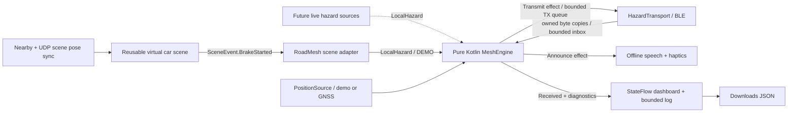

# RoadMesh architecture — expandable base, revision 1

This document describes the implemented starting layer. Interfaces, packet extensions, limits and module boundaries can change as measurements and product requirements arrive. It is not the final architecture. Earlier broader proposals are retained in [archive/architecture-research.md](archive/architecture-research.md).

## Boundaries

`core/` has no Android imports, UI, graphics, inference, I/O or radio callbacks. `MeshEngine` is a single-owner state machine with explicit clock, position and link-policy ports. It returns effects. `RoadMeshApplication` is the small manual composition root. `MeshSession` owns runtime adapters and serializes engine commands; `MeshService` owns the foreground notification and wake lock.

`simulator/scene/` contains the friend's renderer and camera layer. It emits scene events without knowing anything about BLE. `RoadMeshSceneActivity` maps a virtual brake to `LocalHazard(BRAKING, DEMO, sourceEvent)`. The standalone `simulator/app/` extends the same activity. Nearby/UDP are only pose synchronization for that harness; they never carry operational hazards and are disabled in the pitch scene.

## One app and three presentation roles

| Phone | Role | Actual behavior |
|---|---|---|
| A | Detector | Camera/AR scene with a virtual vehicle; Brake starts a deceleration and rear lamp animation, then publishes one DEMO event |
| B | Relay | Accepts A, schedules a relay, decrements TTL, preserves origin/session/sequence and broadcasts the same event |
| C | Observer | Accepts B, checks relevance and displays a caution; emits offline speech and haptics once per accepted event |

Stage role IDs are explicitly assigned 1, 2 and 3. Each phone must have a different role. Road mode uses a persisted random 64-bit node ID and a separately allocated 24-bit diagnostic alias. A new random session nonce is generated at every mesh start. Neither the 24-bit alias nor the 8-bit lastHop field is used for identity, deduplication or suppression.

Stage positions are explicitly synthetic, 100 m apart, heading north. `StageChain` accepts only adjacent role IDs. The radio can physically hear all three phones; the filter deliberately prevents A-to-C acceptance. Starting TTL is 1, A's packet has hop 0, and B's forwarded packet has TTL 0 / hop 1. Therefore C observes **two radio links and one completed relay**. No reverse receipt is implemented. A can report a local burst, not C's delivery.

## Hazard wire format

The existing protocol-v2 `PacketCodec` and its original 27-byte packet remain unchanged in `core/protocol/`. The implemented hazard adapter uses **extended advertising**, not a legacy downgrade, because full identities do not fit into the old packet alone.

Envelope revision 1 is 58 bytes, network byte order:

| Offset | Bytes | Field |
|---|---|---|
| 0 | 27 | Original protocol-v2 core |
| 27 | 1 | Extension tag 0x45 |
| 28 | 1 | Envelope version 1 |
| 29 | 8 | Origin node ID |
| 37 | 8 | Origin session nonce |
| 45 | 4 | Origin sequence, unsigned bit pattern |
| 49 | 8 | Immediate forwarder node ID |
| 57 | 1 | Provenance: DEMO=1, LIVE=2, REPLAY=3 |

Manufacturer ID 0xFFFF is experimental. There is no signature in this revision. SIGNED, PROXY, unknown causes, unknown envelope revisions, malformed length, invalid provenance, identity inconsistencies and invalid coordinates are rejected. The operational engine does not accept bare legacy packets; the original codec remains usable for compatibility experiments. Future signing or richer hazard bodies should use a new negotiated envelope revision, not reinterpret revision 1.

On relaying only TTL, hop, legacy lastHop and full forwarder change. Origin identity, session, sequence, cause, coordinates, generation time and provenance stay constant. A relayed copy is not independent corroboration. The current trust output is always **caution**; authentication and urgent trust tiers are not implemented.

## Admission, relevance and bounded forwarding

Receive order is decode → link policy → own copy/cause/flags/hop budget → provenance → freshness → coordinates/plausibility → bounded neighbor admission → duplicate progress suppression → dedup → origin/neighbor rate limits → receive/announce → relay timer.

The 100 ms generation field is reconstructed to the nearest UTC hour. It is used for a coarse freshness window, with configurable future tolerance. Relay timers and expiry use monotonic time. This does not synchronize phone clocks and is never used to claim end-to-end latency. Rehearsal phones should have aligned system time; clock errors are counted as `stale_or_future`.

Relevance requires a valid own fix and heading, an origin ahead within 400 m, heading difference <=45 degrees and bearing difference <=30 degrees. Missing heading means no spoken caution. Origin distance is checked against the number of traversed radio links and the configurable range envelope. These are experimental gates to tune from field evidence, not verified road thresholds.

Relay delay favors farther receivers: `maxDelay * (1 - min(distance/range, 1)) + jitter`. A valid overheard copy with a higher hop can suppress a pending relay. Distinct full forwarder identities are counted before the duplicate-return path. Pending events expire before transmission. Relay copies keep one event key and cannot repeatedly announce it.

Defaults, all validated through the JSON settings editor:

| Resource | Starting limit |
|---|---|
| Accepted event keys | 4,096, retained 30 s; reject new events when full, preserve live keys |
| Immediate neighbors / origin rate entries | 1,024 each, expire after 30 s |
| Pending relays | 64 |
| Android command inbox / TX queue | 256 / 64; overflow counted, no unbounded backlog |
| Relay bursts / local new events | 3 per second / 2 per second |
| New received events per origin / immediate neighbor | 2 / 8 per second |
| Diagnostic ring | Last 512 entries, 1,000 characters per detail |

The engine remains bounded under dense traffic; overload can reduce delivery. Fleet size alone is not an airtime budget. The 100/300/500-node simulation uses neighborhoods of at most 14 peers across kilometers. Hundreds of radios all in one interference cell are not validated. Adaptive congestion control, priority queues, presence discovery, admission rules and metrics can be added behind these ports after measurements.

## Android runtime

BLE uses one non-connectable, non-scannable extended advertising set at interval 160 (100 ms) and high requested TX power. One TX coroutine serializes data updates (300 ms timeout), enable/disable acknowledgements and finite bursts: 10 requested events for origins, 3 for relays. Advertising is disabled between bursts. A local completion means the controller was enabled and subsequently disabled; it does not prove the number of packets received anywhere.

Scanning filters manufacturer data on 0x52, uses non-legacy low-latency all-match scans with no batching, and restarts after 8 minutes or scan failure through a four-starts-per-30-seconds budget. Silence alone does not prove scan failure: this slice has no continuous presence beacons, so restarting after five quiet seconds would create false watchdog activity. TX failure ends the session visibly; no Nearby, cloud or legacy hazard fallback is hidden behind it.

`MeshService` runs `connectedDevice`, adding `location` only in Road mode. It acquires a timed, renewable partial wake lock and releases transport, location, speech, coroutine and lock resources on Stop. `START_NOT_STICKY` requires an explicit restart after a process kill, so the selected role/profile is visible. OriginOS survival still needs the runbook's screen-off checks. The camera belongs to the visible scene activity; it is not a background camera service.

The engine actor runs as one coroutine on a dispatcher with parallelism one; callbacks only copy and enqueue. TX/export/inference run separately, and Android speech/haptics are dispatched to Main. No engine API assumes a specific dispatcher. Queues are bounded so callback load cannot create unlimited work.

Offline English TTS is selected only from non-network voices, with visual/haptic operation when none is available. Cautions close together are coalesced over 1.5 s to bound speech load. Engine acceptance remains once per event; dismissal only clears the visual card. There is no return ACK, measured PDR, synchronized latency, or claimed playback-completion timing.

Road GNSS accepts recent, accurate, non-mock fixes. Missing GNSS never falls back to a demo track. Road mode rejects DEMO, REPLAY and SYNTH_POS. Live camera/IMU hazard producers are extension points, not connected features in this slice.

## Scene and learning feed improvements

The reusable scene retains ARCore tracking, the GLB car, contact shadows and the Camera2/rotation fallback. Landscape display rotation is applied to both fallback UV mapping and sensor orientation. 3DOF is labeled: turning works, walking does not translate the viewpoint. The car's braking timeline stops without reversing, and only the Brakelight/Taillight material glows; brake discs are not lamp materials.

CPU model data is retained for GL context recreation, GL names are reset before reupload, bitmap data is released after activity teardown, Camera2's handler thread is closed, and overlay invalidation stops on pause. The pitch hides calibration/debug/network controls but the standalone harness keeps them.

Optional inference loads lazily, reports a missing model explicitly, and never gates a brake event. The learning feed resolves the current GL backbuffer before swap, including MSAA, rather than capturing an asynchronously displayed frame with older metadata. It keeps that frame's ID and capture time, flips RGBA rows, and downsizes on the worker. Only one frame can be in flight. `FeedSink` borrows its bitmap synchronously; retaining it requires a copy. This capture path is optional and its GPU/readback cost still requires phone measurement.

The separate scene protocol is revision 2 with a 64-bit session nonce. Revision 1 remains readable with session 0. Old sequences cannot reset the replay window; recent retired sessions remain rejected with bounded history. Scene peers and simulated cars are bounded, and hello-only peers expire. Python monitoring must decode both scene header revisions.

## Next seams to expand

Add live perception or IMU by producing validated `LocalHazard` events through the source contract. Add authentication through an envelope revision and a trust adapter before admission. Add larger deployments through neighborhood measurements, congestion control and simulation scenarios rather than changing UI roles into network roles. Add true latency/PDR only with an explicit measurement protocol and an independent receiver receipt. Add a debrief/LLM by consuming exported events outside the alert path.

Every one of these choices is revisable. Keep migrations explicit and preserve regression vectors when a protocol changes.
