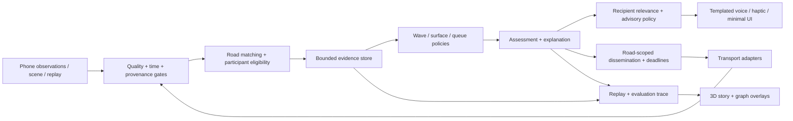

# RoadMesh: cooperative traffic intelligence

Proposal 0.1 · 10 October 2026 · baseline: `c8ddaa6`

**Product idea:** let the road warn the next driver. A phone observes a disturbance; nearby participants combine relevant evidence; a local mesh carries a short, timely advisory toward vehicles that may encounter it. Pedestrian phones can extend communication coverage without being mistaken for traffic probes.

This is an expandable research and implementation plan, **not implemented behavior or a final architecture**. The current shipped base remains described in [architecture.md](architecture.md). Research support and its limits are recorded in [the evidence matrix](research/traffic-evidence.md); presentation design is in [the visual storyboard](demo-traffic-storyboard.md).

The subsequent [junction-flow formulation review](junction-flow-spec.md) develops finite storage, H1–H5 boundary continuity, advisory authority and the first two-junction experiment. It refines JunctionShield's research model without changing the implementation gates below.

## 1. The experience to build

Three capabilities share one evidence pipeline:

| Capability | What the driver experiences | What the system must establish |
|---|---|---|
| **WaveGuard** | “Slow traffic ahead. Prepare to slow smoothly.” | A relevant slowdown or developing backward-moving front, with useful remaining warning time |
| **RoadMemory** | “Rough road reported ahead.” | A persistent, located surface-anomaly candidate supported by qualified observations |
| **JunctionShield** | “Queue beyond the junction. Keep the junction clear.” | Evidence of downstream queueing or spillback along the intended movement |

**Community Relay** supports all three: an opted-in pedestrian, stationary participant or vehicle may carry a useful message. Presentation roles A/B/C are views of the same application, not permanent network tiers.

The memorable demonstration is one chain: **surface defect → braking → a backward-moving wave → queue approaching an intersection → warning reaches the next vehicle through a pedestrian relay.** This is a constructed scenario; it does not claim that potholes cause all phantom jams. A separate ring-road scenario shows waves arising without any physical obstruction.

The pitch sentence: **“We share the developing problem, before the next driver has to discover it alone.”**

## 2. What deterministic means here

We can make inference reproducible: identical versioned evidence, map, parameters and clock inputs produce the same assessment and explanation. We cannot guarantee knowledge of an unobserved pothole, a hidden driver intention, a future lane change or a disconnected road.

Use a deterministic core with explicit uncertainty and abstention:

- Canonical event ordering, stable tie-breakers, explicit units and quantization, bounded windows, injected clocks and seeded simulation randomness.
- `insufficient`, `emerging`, `supported`, `conflicting`, `stale` assessment states. These are policy states, not invented probability percentages.
- Per-field uncertainty and provenance. A model confidence, GPS accuracy estimate, claimed support count and cryptographic authenticity are different quantities.
- Version every algorithm, configuration and map. Record exactly which evidence produced an advisory, including rejected evidence and reason codes.
- Different nodes may reach different conclusions because their observations differ. No instantaneous global consensus or global traffic picture is assumed.

“Early” means **before the recipient encounters the problem**, with time left to respond. For a previously unknown surface defect detected by impact, the first vehicle supplies evidence; subsequent vehicles may benefit. Prediction of emerging waves is a separate, harder capability than detection of a present slowdown.

## 3. Build on the working base

| Existing piece | Retain | Extension required |
|---|---|---|
| Pure Kotlin `MeshEngine` | Explicit effects, injected time/position/link policy, dedup, bounded state | Separate inference from forwarding; policy ports for relevance, scheduling and event families |
| Android `MeshSession` / `MeshService` | Single owner, bounded actor queues, foreground lifecycle, visible failure | Typed observation/inference commands; deadline-aware TX; sensor and energy adapters |
| BLE extended advertising | Actual phone-to-phone transport, capability checks, finite serialized bursts | Measured airtime budget, richer versioned frames, congestion adaptation, receipts where useful |
| Full origin/session/sequence identity | One logical event survives forwarding | Evidence lineage, source-session qualification, persistent record revisions; authentication design |
| DEMO/LIVE/REPLAY separation | Synthetic information cannot silently become live evidence | Apply to every new observation, estimate, advisory and exported trace |
| Friend's car scene | 3D vehicle, brake lamps, camera, scene events | Road context, wave/queue overlays, local explanation views; keep graphics independent of inference |
| Logical fleet simulation | Seeded loss, TTL/dedup/partition/resource checks | Traffic dynamics, partial observation, deadlines, human response and real-device measurements |

Current limits matter to the migration: the 58-byte envelope is unsigned; it carries braking, not rich road state; time is reconstructed modulo an hour; dedup retention is short; there are no receiver receipts. Relevance is an ahead/heading cone, not road matching. The 100/300/500-node tests model limited neighborhoods over an area, not hundreds of phones competing in one RF cell. These are good foundation boundaries to extend explicitly.

The existing stage chain uses synthetic positions and an adjacency acceptance filter. A → B → C is **two radio links and one relay**, not proof that A physically cannot reach C. No new plan should erase this distinction.

## 4. A graph problem with distinct graphs

| Graph | Vertices and edges | Job |
|---|---|---|
| Directed road graph `G_road` | Road segments / junction movements and legal connectivity | Match observations, determine who approaches a hazard, model queues and candidate routes |
| Temporal contact graph `G_radio(t)` | Participating devices and observed usable contacts | Carry information before it expires; tolerate asymmetric links, sleep and partitions |
| Evidence graph `G_evidence` | Observations, aggregates and assessments connected by derivation | Prevent double counting; explain conclusions; propagate corrections |
| Local wait-for graph `G_wait(t)` | Junction movements depending on receiving road space | Find possible spillback cycles; distinguish blocked discharge from ordinary red phases |

A relay's location is not the hazard's location. A pedestrian walking south can relay a northbound warning. A radio neighbor on a flyover is not necessarily a relevant road neighbor. A cycle in a street map is normal; only evidenced blocked dependencies belong in the wait-for graph.

Do not solve a global traveling-salesperson problem. Start with bounded local estimation, robust change detection, graph reachability, strongly connected components and deadline scheduling. Add network-wide route optimization only when the observation and response models justify it.

## 5. Contracts before additional features

These are logical contracts, not a commitment to new Gradle modules or byte layouts. Begin as packages with constructor-injected policies; split modules only when independent ownership or dependencies make it worthwhile.

| Contract | Minimum meaning |
|---|---|
| `Observation` | Immutable ID; source session; capture time and uncertainty; location/road candidates and uncertainty; participant/sensor eligibility; compact features; provenance; quality; evidence lineage |
| `TrafficEstimate` | Directed region; validity interval; measured versus inferred fields; coverage gaps; model/config/map version; bounded support references |
| `HazardRecord` | Stable record identity and revision; kind; footprint; active/expired/disputed state; original observations; refresh/expiry policy |
| `Advisory` | Hazard/assessment revision; affected road region and approach; semantic action template; age/deadline; applicability and abstention reasons |
| `Receipt` | Exact event/revision and stage: received, accepted or presented; local timestamp semantics; bounded return policy |
| `DecisionTrace` | Input IDs, policy versions, assumptions, chosen output, suppressed output reasons and operational counters |

On the wire, an original observation and a derived assessment/advisory are different frame types. A derived object has its own issuer/revision, bounded original-support references and a lineage-completeness/overlap state. Receiving it never creates a new independent observation. Truncated lineage or a digest-only reference remains non-additive evidence until its support can be resolved within a budget.

Use ports such as `ObservationSource`, `RoadMatcher`, `EvidenceStore`, `TrafficEstimator`, `HazardPolicy`, `AdvisoryPolicy`, `DisseminationPolicy`, `Transport` and `TraceSink`. Avoid a general plugin framework until two real implementations need it. An optional on-device language model may explain an exported trace; the alert path remains typed and templated.

### Evidence merge rules

1. Forwarding preserves origin and derivation. Ten relays of one observation remain one observation.
2. Repeated samples from one source help estimate that source's trajectory; they do not become ten independent vehicles.
3. Merge overlapping support by set union of bounded IDs, never by adding aggregate counts. Unknown overlap means independence is unknown. A digest proves neither complete membership nor independence.
4. Distinct unsigned IDs are **claimed sources**, not authenticated vehicles. Even signed devices can share a vehicle. Provision known participants for controlled experiments; evaluate open-network support separately.
5. Expiry and contradiction are first-class. A source driving away does not clear a pothole. A new “clear” claim cannot erase older evidence without a specified authority and version policy.
6. Keep support sets and decision windows bounded. Retention caps, eviction and late-arrival policy are part of the versioned algorithm. Given the same finalized window, order-independent merges should agree; real-time pre-finalization decisions need not.

Replay protection must cover the admitted lifetime plus clock tolerance. Long-lived road records cannot inherit the current short event-dedup retention: retain suitable replay state/tombstones, shorten admitted lifetime or reject new work when safe retention cannot be maintained.

## 6. Algorithms worth building first

The following algorithms are **proposed adaptations**, not results established by the cited papers. Every threshold is a named calibration parameter. Tune on training scenarios and freeze before held-out evaluation.

### 6.1 Observation quality and road matching

Process raw IMU and optional images locally; send events and sufficient statistics, not raw streams. A mounted phone can estimate gravity-aligned acceleration and combine it with GNSS speed. A loose or handled phone must reduce sensor eligibility. Low speed alone cannot classify a pedestrian: a car in a queue is also stationary. Initial research sessions use explicit participant mode plus consistency checks; unknown mode can relay but does not supply vehicle-speed evidence.

Baseline road matching: short directed-road candidate sets using position, heading when reliable, legal transitions and trajectory continuity. Retain alternatives at parallel roads, flyovers and junctions. A sliding-window HMM/Viterbi matcher is a later extension inspired by [Newson and Krumm](https://www.microsoft.com/en-us/research/wp-content/uploads/2016/12/map-matching-ACM-GIS-camera-ready.pdf); their published algorithm is batch-oriented, so online lag and ambiguity handling require evaluation.

For `T` fixes and at most `K` candidates, dynamic programming is `O(T K²)` plus bounded route-distance queries. Cache local road distances; cap candidates and horizon. Without a trustworthy road association, offer only a suitably broad caution or abstain; do not issue lane-specific instructions.

### 6.2 WaveGuard: from slowdown events to a wave forecast

**Cause:** small braking variations can amplify through following behavior, producing a backward-moving front even without an obstruction. The [Sugiyama experiment](https://doi.org/10.1088/1367-2630/10/3/033001) establishes that mechanism. It does not establish that every clustered brake report is a phantom jam.

**Cheap baseline:** persistent, spatially consistent slowdowns from qualified vehicle probes on one directed corridor. Output “slow traffic ahead” before trying to classify its cause.

**Wave extension:** each qualified episode contributes one slowdown onset `(s_i, t_i)`, where `s` increases along travel direction. Group only compatible episodes; do not merge independent waves across a junction. Estimate propagation speed using a bounded Theil–Sen median of pair slopes:

`c = median((s_j - s_i) / (t_j - t_i))`

Only include pairs whose time separation exceeds combined clock uncertainty and the configured minimum. Require enough qualified episodes, negative propagation across the uncertainty envelope, acceptable residuals and persistence over windows. Multiple phones in one known vehicle share one contribution budget. Robust fitting rejects some outliers; it does not authenticate the remaining reports.

For a receiver behind a front at a common reference time, a first conditional forecast is:

`encounter_time = (s_front - s_receiver) / (v_receiver - c)`

Require positive, well-separated closing speed, a valid corridor and an uncertainty range that does not span incompatible cases. Propagate measurement uncertainty and allow model error. Pair-slope dispersion is not a calibrated confidence interval. Calibrate forecast interval coverage on held-out data; until then label it a sensitivity range.

At decision time, project the front and recipient to that same time, then subtract only **remaining** compute/queue/radio/human-response allowances from earliest plausible encounter. Do not subtract elapsed message age twice. If the remaining margin is inadequate, withhold the early-forecast claim; a separate current-condition warning may still apply.

There are `O(M²)` candidate slopes for a hard cap `M` on episodes. Materializing them needs `O(M²)` scratch memory, alongside `O(M)` retained episodes; linear median selection gives `O(M²)` fit work, while sorting slopes gives `O(M² log M)`. Start with modest bounded sets and profile on the phones. No city-wide optimization or neural network is necessary for this baseline.

**What may help:** early awareness and smoother preparation. [Stern et al.](https://fangyuwu.com/data/stern_2017.pdf) tested both automated control and a specially instructed human driver on a ring. Ordinary drivers responding to a brief RoadMesh warning are a different intervention; measure that response before claiming wave reduction.

### 6.3 RoadMemory: a rough-road candidate becomes shared memory

**Cause:** a surface defect can produce an impact and induce braking or evasive behavior. Similar signals can arise from speed bumps, bridge joints, rail crossings, phone handling and suspension differences.

**Local baseline:** vehicle-mode and mounting-quality gate → orientation/gravity correction → bounded high-pass/peak/shape features → speed-conditioned candidate. [Pothole Patrol](https://www.cs.uic.edu/~jakob/papers/p2-mobisys08.pdf) and [Nericell](https://www.microsoft.com/en-us/research/wp-content/uploads/2016/02/Nericell-Sensys2008.pdf) motivate these features; their results are not phone-independent thresholds.

**Fusion:** cluster candidates by directed road coordinate and overlapping location uncertainty, not an arbitrary fixed GPS dot. Use a bounded spatial index with adjacent-cell checks; cap cluster extent to prevent chaining nearby unrelated defects. Retain independent-pass lineage, sensor class, speed band, age and negative examples. Use deterministic tie-breaking and weighted medoid/robust position estimates; never show false lane or depth precision.

Begin with `rough-road candidate`; stronger classification needs labeled data or an independently validated vision detector. Repetition alone does not distinguish a pothole from a speed bump. A qualified nondetection is contradictory evidence only when the sensor was active, capable and traversed the relevant footprint; an uninstrumented pass says nothing.

Index lookup is typically `O(log H + k)` for `H` retained clusters and `k` neighbors examined; dense cases remain bounded by explicit limits. Static record lifetime is separate from a braking event's lifetime. Use revisioned refresh, decay and dispute policies; no indefinite “sticky” hazard and no unauthenticated instant deletion.

Driver output remains a rough-road caution. Do not prescribe swerving or a lane change from a phone-scale location estimate.

### 6.4 JunctionShield: recognize receiving-space risk

**Cause:** an incoming movement may have a permissive signal while its receiving segment lacks space. Queues can extend into upstream junctions and create mutually blocked movements. Ordinary red-phase queues and temporary stops are not deadlock.

**First baseline:** retain persistent slow/stopped observations by directed segment and turn movement where known. States are `observed slow/queued`, `recently observed traversable`, `unknown`, `conflicting`, `stale`. Recent successful traversal is evidence about that traversal, not a guarantee of present free capacity.

Report an observed stopped extent only if queue association and head location are supported. It may be a lower bound on an associated queue's extent; it is not a count of all queued vehicles. A newly appearing upstream probe can make the apparent tail jump without any queue growth. Estimate growth only with temporal association and sufficient repeated coverage; otherwise omit spillback ETA.

**Finite-storage extension:** use known road length, movement topology, plausible discharge and calibrated storage ranges. A simple uniform-cell conservation model can be explored offline:

`S_i = min((v_f Δt / L) n_i, Q Δt)`

`R_i = min((w Δt / L) (N_i - n_i), Q Δt)`

`y_i = min(S_i, R_(i+1)); n_i' = n_i + y_(i-1) - y_i`

Here `n` and `N` are vehicles and storage with `0 <= n_i <= N_i`, `Q` is vehicles/second, `L` is metres and `v_f,w` are metres/second. Use `w > 0` for the backward congestion-wave speed **magnitude**, unlike the signed negative `c` in the wave fit. Choose a stable discretization, include boundary flows and calibrated junction allocation; require `max(v_f,w) Δt / L <= 1` for this simple cell choice. This is a restricted proposed CTM-style model, motivated by [Daganzo](https://its.berkeley.edu/publications/cell-transmission-model-dynamic-representation-highway-traffic-consistent-hydrodynamic), not a ready estimator of unknown density from phone counts.

Unknown market penetration, turn proportions, motorcycles, lane mixing and missing signal timing can leave very wide state bounds. Do not force bounds narrow using unobserved quantities. [Low-penetration estimation research](https://arxiv.org/html/2404.08667v1) explicitly depends on assumptions about arrivals, participation and signal parameters; retain an `unknown` result when those assumptions fail.

Build wait-for edges only for evidenced blocked movements that depend on downstream receiving space. Run Tarjan strongly connected components, `O(V+E)`, in a bounded junction neighborhood. A candidate cycle additionally needs persistence, observed blocking at each dependency and examination of discharge/escape paths. Missing signal or turning information prevents a proven-deadlock claim. Output “possible spillback cycle” to the demonstrator; drivers receive a simple queue/keep-clear message.

[Capacity-aware back-pressure](https://arxiv.org/html/1309.6484) motivates accounting for finite receiving space. Its signal-control guarantees do not transfer to phone advisories. RoadMesh has no authority to assign right of way, release a signal phase or instruct a vehicle to enter an intersection.

### 6.5 RouteGuard: experimental later phase

Default to awareness before recommending another route. Routing changes traffic: sending everyone to the currently fastest side road may create the next queue. [Krall et al.](https://arxiv.org/abs/2105.11790) demonstrate delay-induced route-choice oscillations in models and simulations.

A later time-dependent graph cost may combine expected travel time, uncertainty, receiving capacity, restrictions and diversion externalities. It needs current evidence about the alternative, turn legality, restrictions and user route context. Use improvement thresholds, commitment windows, hysteresis and a bounded recommendation share. A session-stable hash can allocate an experimental share; it does not solve global coordination or guarantee fair outcomes during partitions. Never treat an unobserved alternative as uncongested.

Use bounded candidate-path search and evaluate whole-network outcomes, not just the redirected drivers. Keep this behind a research flag until the simpler warning intervention and driver response are validated.

## 7. Information routing: send usefulness, not everything

The objective is timely relevant coverage under airtime, energy and queue constraints. A global minimum-transmission solution with perfect future contacts is unavailable; use a local heuristic and compare it to simple baselines.

1. Compute the affected **road region** and required warning horizon. Follow upstream road connectivity, including relevant approaches, rather than broadcasting to a circular radius indefinitely.
2. Preserve original capture time, expiry, provenance and lineage across hops. At a receiver, derive one age interval from the explicit clock/transfer model and advance it by local monotonic elapsed time. Do not add dwell again to a source-to-current-clock age that already includes it. If using carried age instead, include unmeasured transfer/scan delay in its error budget. Unknown bounds disqualify deadline-critical fusion. A new assessment cannot reset the age of its support; evidence freshness, static-record validity and packet lifetime remain distinct.
3. Deduplicate and coalesce superseded state per hazard/revision. Keep short-lived disturbance events separate from slower road-memory refreshes.
4. Admit bounded priority classes with earliest-deadline scheduling within each class, per-origin/global budgets and a fairness allowance. Drop expired work again immediately before radio transmission. FIFO backlog must not consume the warning horizon.
5. Use geographic progress and measured recent contacts to favor useful relays, with suppression and bounded jitter to reduce simultaneous retransmission. Keep a limited recovery path where greedy progress fails; do not promise delivery through a partition.
6. Permit store-carry-forward only while the record remains useful. It fits persistent surface hazards better than an expiring hard-brake event. A valid path is a sequence of contacts in time, not merely nearby dots on a map.
7. Add sparse, sampled or explicit-demo receipts. Distinguish local TX completion, received, accepted, presented and driver response. Avoid an ACK from every node for every broadcast.

Use a new envelope revision for new bodies and authentication. Do not squeeze rich evidence and a signature into the existing 58 bytes by silently dropping semantics. Measure complete encoded size, advertisement support, airtime and loss before choosing compact summaries, bounded fragmentation or occasional connection-oriented detail exchange. Unknown required versions/types fail visibly; mixed profile hop budgets need explicit interoperability tests.

Extend transport callbacks to preserve available receive time, RSSI/PHY and capability metadata. These are observations about contacts, not guaranteed range or reverse connectivity. Suppress a relay only on comparable progress toward the same affected road branch: a farther downstream copy must not cancel the only useful upstream forwarder. The rationale comes from [broadcast-storm research](https://people.eecs.berkeley.edu/~culler/cs294-f03/papers/bcast-storm.pdf), [contention-based forwarding](https://publications.cs.hhu.de/library/Fuessler2003b.pdf) and [information-age research](https://arxiv.org/abs/2007.08564), with new BLE-specific evaluation still required.

BLE is a transport option behind a stable contract. The existing custom application mesh is not automatically Bluetooth SIG Mesh, C-V2X or ITS-G5. A future transport can share the same evidence and advisory rules without changing the scene or traffic algorithms.

### Pedestrian participation

An explicit opt-in mode grants a small energy/storage/airtime budget, visible status and immediate Stop. Participant type, sensor eligibility and relay capability are separate fields. A pedestrian's walking speed never enters a vehicle speed or queue estimate; coarse “on foot” classification alone is not a safety guarantee. Optional pedestrian hazard reports are a separate evidence class.

Forward the event's original road scope even when the carrier moves to another road. Do not require raw pedestrian trajectories to be shared merely to relay bytes. Evaluate screen-off, process death, battery saver, OEM behavior, permissions and capabilities on the actual phones; [Android background BLE guidance](https://developer.android.com/develop/connectivity/bluetooth/ble/background) is a starting point, not an availability guarantee.

### Trust and privacy

For a controlled demo, provision participants and label that boundary. For an open deployment, authentication, replay defense, pseudonym rotation and admission require their own threat model. Signatures attest an identity, not sensor truth or independent vehicles. [The Sybil attack](https://www.microsoft.com/en-us/research/publication/the-sybil-attack/) is directly relevant to claimed corroboration.

Rate-limit before expensive work; bound reassembly and signature verification; prevent forged forwarders from cheaply suppressing legitimate alerts. Avoid persistent cleartext identifiers and unnecessary position sharing, while retaining a scoped identity long enough to deduplicate and limit influence. Rotate by a designed session/epoch policy, not on every packet. Raw sensor data stays local by default; exported research traces need explicit participant handling.

## 8. Validation that can support the pitch

Keep three experiments separate: **inference correctness**, **message delivery**, and **traffic effect**. Passing one does not prove the others.

| Experiment | Inputs / baselines | What to report |
|---|---|---|
| Deterministic replay | Fixed observations/config; reordered duplicates; overlap; clock faults; restarts | Same finalized assessment, bounded state, explanation consistency, expiry correctness |
| Detection and forecast | Labeled traces; local-only threshold; current brake relevance; proposed fusion | Event precision/recall, false alerts/km, abstention, useful lead time, interval coverage and false road association |
| Radio / dissemination | Actual 3-phone traces, controlled loss and churn, pedestrian gap; simple bounded flooding | Deadline delivery to eligible recipients, age at use, transmissions/useful warning, queue drops, energy/thermal behavior |
| Traffic effect | No advisory, local-only, mesh advisory, perfect-information oracle; identical exogenous demand | Travel time distribution, throughput, queue spillback time, speed variation, hard-braking surrogate, diversion burden |
| Human response | Parked comprehension study, then controlled low-risk study with defined response protocol | Comprehension, warning timing, annoyance, distraction, actual compliance and response delay |

Use the existing logical mesh tests for regression, a version-pinned SUMO/TraCI offline harness for traffic, and the same pure Kotlin policies for replay and Android. Do not add SUMO to the phone runtime. [SUMO supports seeded runs](https://sumo.dlr.de/docs/Simulation/Randomness.html); also pin version, networks, parameters and platform because seed alone does not eliminate every reproducibility difference.

Paired counterfactuals share demand, starting conditions and exogenous random streams. After advice, trajectories are allowed to diverge; a prerecorded replay cannot measure the traffic effect of an intervention that would change those trajectories. Run multiple held-out seeds and report distributions, not one favorable animation.

The ground-truth simulator is available only to evaluation and the clearly labeled audience view. The algorithm sees a masked subset with noisy fixes, delayed/dropped messages and unknown penetration. Include cars, buses/trucks and two-wheelers, urban geometry and different driver responses. Use penetration, loss and compliance sweeps as experimental conditions—not claimed real-world rates.

Use [pNEUMA](https://open-traffic.epfl.ch/) for urban trajectory context and probe thinning where licensing permits; it does not supply phone IMU or BLE ground truth. Collect labeled mounted-phone impact traces for RoadMemory, including bumps, braking, handling and smooth roads. Separate sites/devices/vehicles between training and evaluation to avoid leakage. [RDD2022](https://arxiv.org/abs/2209.08538) is optional vision research, not proof of impact detection or pothole depth.

SUMO's [TTC/PET and other surrogate measures](https://sumo.dlr.de/docs/Simulation/Output/SSM_Device.html) can help inspect simulated conflicts. They do not establish accidents prevented. Report communication lead time with a defined reference clock: source-clock round-trip time is possible with a receipt; one-way latency needs measured clock error. Receiver presentation is not driver action.

Mandatory adverse cases: unknown map, parallel roads, stale clocks, one phone in a bus, multiple phones in one car, forged IDs, overlapping summaries, radio partition, relay moving away, low participation, queue tail coverage changing, red-light queue, hazard contradicted, overloaded airtime and an alternative route becoming congested.

## 9. Incremental delivery plan and gates

No calendar estimate is invented here; advance by evidence and keep each slice demonstrable.

| Slice | Work | Exit gate | Visible result |
|---|---|---|---|
| **0 — Preserve the base** | Run existing phone acceptance; record capability/build/config; collect stage logs | A/B/C chain and failure states reproducible on loaners | Existing car braking and real relay |
| **1 — Make evidence inspectable** | Logical contracts, bounded trace/replay, participant eligibility, quality/lineage and declared corridor geometry; wire feasibility design | Duplicates/overlap do not inflate support; unknown and stale cases visible; evidence frames fit a measured transport budget | Tap a warning to see why it exists |
| **2 — WaveGuard vertical slice** | Scripted/recorded slowdown observations → baseline then wave estimator → observer caution; explicit corridor association and compatible evidence/assessment protocol | Held-out inference replay meets predeclared error/usefulness criteria; base-transport timing measured; road-scoped delivery remains gated on slice 3 | Warning shown before the scripted follower reaches the wave |
| **3 — Community Relay + deadlines** | Road-scoped forwarding, deadline queues, sparse receipt and opt-in pedestrian mode | Expired work never presented; receipt stages honest; screen-off and partition results documented | Pedestrian bridges a demonstrated contact gap, or failure is shown |
| **4 — RoadMemory** | Mounted-phone features, clustering, revision/expiry/dispute, negative examples | Evaluation across devices/mounts distinguishes candidate from stronger classification | One impact becomes a shared rough-road memory |
| **5 — JunctionShield** | Road movements, observed queues, finite-storage model experiments, wait-for SCC | Red queues and changing coverage do not masquerade as deadlock; uncertainty retained | Receiving-space and possible-cycle overlay |
| **6 — Effect and scale** | Paired traffic experiments, human response, dense RF and energy profiling | Published conditions and measured distributions support only the claims made | Counterfactual twin with auditable results |
| **7 — Later expansion** | RouteGuard, vision/proxy sensing, other transports, optional infrastructure | Separate evidence and interoperability gate for each | New modules use the same contracts |

If time is short, finish slices 0–3 with one coherent wave scenario. Keep RoadMemory/JunctionShield as clearly labeled previews rather than three shallow features. Slice 2 can use scripted vehicle evidence from known virtual participants; label it as such and never count those as physical phones.

## 10. Orchestration and review ownership

This proposal used a fresh Orca run `run_e71e91933500`, without resuming the original provider session:

- **Claude:** primary traffic literature, wave/queue algorithms, disconfirming evidence and assumptions.
- **Antigravity:** three-phone visual choreography, audience comprehension, counterfactual presentation and failure visibility.
- **Codex worker:** BLE dissemination, Android participation, schema/lineage and repo feasibility.
- **Coordinator:** primary-source verification, architecture integration and decision gates; an independent review stress-tested uncertainty, queue identifiability and causal evaluation.

Agent conclusions were reviewed rather than accepted as authority. In particular, the final evidence distinguishes Stern's trained-human experiment from automated control, and does not call a new probe appearing upstream proof of queue growth. Unmeasured visual-draft latency, confidence and traffic-benefit numbers were removed; the three-layer presentation concept was retained.

After plan review, work can be dispatched as a dependency graph: contracts/replay → parallel algorithm and transport slices → scene integration → independent adversarial review → phone rehearsal. Assign nonoverlapping ownership; give each task input/output contracts, a bounded scope and an exit gate. Require a concrete report before accepting a feature as complete.

## 11. The decision proposed now

Approve the direction of an **evidence-first cooperative warning system**, with WaveGuard as the first complete new slice, Community Relay as the communication story, and RoadMemory/JunctionShield following through shared contracts. Keep route optimization, numeric speed prescriptions and infrastructure control outside the initial delivery gate.

The differentiator is the combination: local sensing, explainable road reasoning, deadline-aware dissemination and a visual proof of where the evidence came from. Neither universal deterministic traffic prediction nor a novel research breakthrough is claimed. No product code was changed as part of this proposal.

Review status: local document links and new-file whitespace checked; an independent algorithm review resolved lineage, clock accounting, wave-fit complexity and cell-model sign conventions. The accompanying concept visual passed syntax and 48 scenario/relay/moment checks in an offline DOM at narrow and wide widths, including state restoration. No browser was connected for screenshot inspection. No Android build, radio experiment, new traffic simulation or field-validation result is claimed for this documentation-only change.
