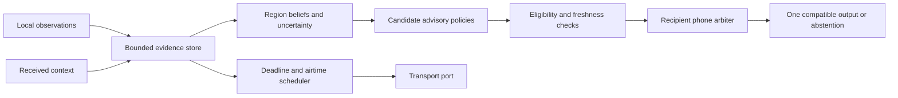

# RoadMesh junction flow formulation and experiment plan

Draft 0.1 · 10 October 2026 · extends the [cooperative traffic plan](cooperative-traffic-plan.md).

RoadMesh should reduce the risk and duration of junction blockage by giving useful advice before drivers reach constrained road space. The supplied junction-flow formulation captures the right priorities: safety, finite storage, continuity and efficiency. Its expandable foundation is a **partially observed advisory system with local software guarantees and conditional traffic predictions**. A decentralized stochastic MPC formulation is a research direction; a bounded comparison of a few advisory policies is the first experiment.

This review combines the repeated sections supplied in the conversation into one problem. It does not authorize product implementation, fix the final architecture, or claim measured traffic benefits. The existing application and 58-byte unsigned protocol remain unchanged.

## What can be guaranteed

| Requirement | Appropriate guarantee |
|---|---|
| Preserve event identity, bound memory and airtime, reject expired proposals | Hard software invariants under a declared lifetime, restart and clock model |
| One compatible advisory output on a nominated phone | Hard local arbitration invariant; zero maneuver advisories is allowed |
| Correctly identify every road user across regions | An estimation objective with missed detections, false merges, splits and identity switches |
| Agree on actor state | A consistency diagnostic conditional on association, coordinate frame, time and uncertainty |
| Deliver context before a boundary | A measured availability and deadline target under stated operating conditions |
| Prevent spillback and reduce delay | Conditional predictions and experimentally evaluated outcomes |
| Never cause any collision or increase any vulnerable user's risk | A safety objective; not an unconditional theorem available from uncertain phone observations and uncontrolled human behavior |

Safety-related identity handling, output arbitration and expiry cannot sit below overflow in a lexicographic objective: the optimizer must never trade them away to improve throughput. Comfort, context completeness and readiness can have measured service targets. A safety filter can enforce its declared decision rules; that alone does not prove real-world collision freedom. With insufficient evidence, reject the specific maneuver proposal. Any remaining caution still needs its own relevance, freshness and attention checks.

## State and conservation

Keep the directed road graph, movement graph and conflict geometry. Distinguish physical actors, sensing devices, observation records and uncertain tracks: one phone is not necessarily one vehicle, and an unequipped actor can still be observed by another sensor.

Use different symbols and units:

| Symbol | Meaning | Unit |
|---|---|---|
| $n_s,N_s$ | Occupancy and storage capacity | PCU |
| $Q_s$ | Queued traffic amount | PCU |
| $\ell^{queue}_s$ | Spatial extent of an associated queue from the downstream boundary | m |
| $L_s,\beta_s$ | Segment length and upstream keep-clear buffer | m |
| $c_m$ | Movement saturation rate under its stated service conditions | PCU/s |
| $g_m,h_m$ | Amount entering and exiting a junction movement during one step | PCU |

The original comparison $q_s\ge L_s-\beta_s$ mixes PCU and metres. Replace it with $\ell^{queue}_s\ge L_s-\beta_s$. Estimating length from queued PCU requires a calibrated spatial packing model; total stopped PCU does not determine which lane reaches the upstream junction. Mixed traffic and pedestrians require geometric footprint and movement information in addition to aggregate PCU. PCU conversion is not a collision or pedestrian-space model.

The storage approximation $N_s=k_{jam,s}L_s\ell_s$ requires $k_{jam,s}$ in PCU per metre per lane. Treat its calibration as uncertain and condition-dependent. Fix PCU weights within a conservation experiment; changing weights mid-run must not appear as traffic arriving or disappearing.

### Road cells and junction transit

For a simple uniform road cell of length $\Delta x_i$, use the proposed triangular-fundamental-diagram approximation

$$
S_i=\min\left(\frac{v_{f,i}\Delta t}{\Delta x_i}n_i,c_i\Delta t\right),\qquad
R_i=\min\left(\frac{w_i\Delta t}{\Delta x_i}(N_i-n_i),c_i\Delta t\right).
$$

Here $w_i>0$ is the backward congestion-wave speed magnitude, in m/s. Require $\max(v_{f,i},w_i)\Delta t/\Delta x_i\le1$ for this simple discretization. The user's $\omega(N-n)$ needs a dimensionless coefficient; if $\omega$ is a speed, it is missing $\Delta t/\Delta x$. Sending all of a long segment's occupancy in one 0.5-second step also ignores travel time. Subdivide segments and use a calibrated node allocation model. This is a restricted adaptation motivated by [Daganzo's 1994 network CTM report](https://escholarship.org/content/qt9pz309w7/qt9pz309w7.pdf), whose cell normalization and source/gate construction support these modeling choices. It is not a complete mixed-traffic junction model.

If the junction has its own nonzero occupancy, segment-to-segment flow cannot be instantaneous. Let $z_m$ be occupancy in movement $m$:

$$
z_m(t+1)=z_m(t)+g_m(t)-h_m(t),\qquad n_j(t)=\sum_{m\in M_j}z_m(t),
$$

$$
n_s(t+1)=n_s(t)+\sum_{m:out(m)=s}h_m(t)-\sum_{m:in(m)=s}g_m(t)
             +a_s(t)-b_s(t).
$$

Here $a_s,b_s$ are admitted external entry and exit amounts in PCU during the step. Junction transit needs internal cells or travel-time cohorts; the equations alone must not let an actor enter and exit instantly. Sending, receiving, conflict compatibility and legal service constrain these flows. For shared receiving cells, junction exits and driveway arrivals consume the **same** receiving budget.

Represent external demand explicitly. For example, a driveway/source backlog obeys $B_s(t+1)=B_s(t)+D_s(t)-a_s(t)$. Retain unserved demand in the world and the metrics. Physically unobserved actors are still present in the ground-truth dynamics; they are not arbitrary creation noise. Unexpected intrusion or model error may violate the simplified model and must be detected, not hidden by clipping occupancy.

A finite-storage model can enforce $n_s\le N_s$ by blocking all incoming traffic even during complete gridlock. Therefore that inequality alone is not a success metric. Measure queue invasion of the buffer, blocked movement time, junction residence time, throughput and source backlog. A policy that merely moves congestion outside the measured area has not solved the problem.

### Conflict occupancy

For a finite conflict zone $k$, let $[t^{in}_{a,k},t^{out}_{a,k}]$ be actor $a$'s occupied interval, including its footprint. A modeled clearance requirement is the disjunction

$$
t^{out}_{a,k}+h_k(\kappa_a,\kappa_b)\le t^{in}_{b,k}
\quad\text{or}\quad
t^{out}_{b,k}+h_k(\kappa_b,\kappa_a)\le t^{in}_{a,k}.
$$

An arrival-time difference is insufficient: a bus occupying the zone from 0 to 4 seconds and a car entering at 2 seconds can satisfy a one-second arrival gap while overlapping. PET is the later entry time minus the earlier actor's exit time. [SUMO's definition](https://sumo.dlr.de/docs/Simulation/Output/SSM_Device.html#pet) supports that distinction; PET remains a surrogate, not a universal safe-gap certificate.

Use uncertainty in both intervals, actor geometry, lawful priority and vulnerable-user exposure. RoadMesh cannot schedule unequipped road users or grant right of way. Receiving SPaT information would improve observation of signal timing; actuating signals would require a separate authorized interface and control regime. [Connected Intersections SPaT brief](https://engineering.virginia.edu/sites/default/files/Connected-Vehicle-PFS/Resources/CV%20PFS%20SPaT%20Fact%20Sheet%2003072022.pdf)

## Observation and boundary continuity

The true actor set $A(t)$ belongs to the world model. Each participant sees only a partial observation history. Do not give its optimizer the full actor set, true penetration, signal phase or simulator queue state unless that information is explicitly supplied through a modeled sensor.

A single Gaussian is reasonable only within a resolved movement hypothesis. Preserve separate road, flyover, lane or turn alternatives when ambiguity matters. A mixture or bounded hypothesis set can retain those alternatives; taking their mean can place an actor on a nonexistent road.

There is no universal minimum penetration $p$. As a simple identifiability example, a Poisson population count with mean $\Lambda$, independently sampled with unknown probability $p$, gives a probe count with mean $p\Lambda$. Probe counts alone cannot identify both factors. Biased participation makes inference harder. Define the target accuracy, observation duration, geometry, other sensors and sampling assumptions before estimating a useful penetration range. [Sparse-probe estimation research](https://arxiv.org/html/2404.08667v1) makes material arrival, penetration and signal assumptions.

### Revised H1 through H5

| Item | Revised requirement | Failure behavior |
|---|---|---|
| H1 Identity | Preserve immutable observation IDs and idempotent context application within the admitted replay horizon. Maintain uncertain physical associations separately. | Retain unmatched/ambiguous tracks; measure missed, split, merged and switched identities. Do not force a bijection. |
| H2 Agreement | Compare associated hypotheses at one reference time, in a shared coordinate frame and compatible map/rule versions. | Mark disagreement and abstain from dependent inference; preserve original evidence. |
| H3 Authority | One nominated recipient phone serializes its output. Region nodes produce proposals, not commands. | Permit no maneuver advisory; reject stale session epochs and incompatible proposals. Two phones in one vehicle require explicit nomination to claim one audible adviser per vehicle. |
| H4 Readiness | Meet a measured preparation deadline with stated availability and uncertainty. Check evidence freshness separately. | Continue eligible local-only operation; do not stop a car merely because a logical region boundary was crossed. |
| H5 Smoothness | Bound changes of numeric advice; use hysteresis/commitment for discrete route changes and an attention budget for presentation. | Expiry and safety invalidation override comfort. Measure actual human acceleration/jerk separately. |

For aligned continuous estimates, an agreement residual and its covariance are

$$
r=\mu_s-\mu_j,\qquad S=P_s+P_j-C_{sj}-C_{sj}^{T}.
$$

The cross-covariance $C_{sj}$ matters when nodes share evidence. Using $P_s+P_j$ without justification assumes independent errors. Unknown correlation may motivate conservative fusion, but it does not cure association mistakes, bias or malicious reports. Retain exact bounded evidence lineage; merging overlapping support does not add independent vehicles.

A sheaf energy can organize these consistency checks once restriction maps and shared state spaces are defined. It is not an accuracy certificate: two nodes can agree on the same wrong location, and inflated covariance can reduce a Mahalanobis residual. Track absolute uncertainty, coverage, unmatched actors and per-overlap violations alongside any total energy; more overlap terms also change the total. The [sensor-integration sheaf framework](https://arxiv.org/abs/1603.01446) is useful background, not a requirement to add a sheaf solver to the first version.

Do not make global leader election a prerequisite for a phone to present a caution. If a linearizable shared ownership register is later required, continuous availability and strict consistency cannot both be promised under arbitrary partitions; see the [Gilbert–Lynch proof](https://groups.csail.mit.edu/tds/papers/Gilbert/Brewer6.pdf). Local arbitration avoids that distributed ownership requirement for one recipient's output. It does not guarantee coordinated plans for every driver.

### Timing the overlap

Use a conditional target such as

$$
\Pr\{D_{prepare}\le T^{-}_{boundary}\mid\mathcal I_t,\text{operating conditions}\}
\ge1-\epsilon_{ready}.
$$

Preparation includes discovery, queuing, required exchanges, decoding/verification, solving and output scheduling. Boundary arrival uses conservative position, speed and acceleration estimates. An illustrative bound with a genuine speed upper bound is

$$
L_\Omega\ge v_{max}D_{budget}+\delta_{position/map}.
$$

The user's calculation is correct under its assumed bounds: $(60/3.6)\times(0.5+0.3+0.5)=21.67$ m before position uncertainty. Neither 0.5-second BLE communication nor a 50-m overlap is established by that arithmetic. Include disconnections and process loss when estimating deadline probability; successful-packet latency alone hides unavailable service. A partition can make remote preparation impossible. [Android background BLE guidance](https://developer.android.com/develop/connectivity/bluetooth/ble/background) describes relevant lifecycle constraints.

Do not add elapsed evidence age twice. Preparation readiness and whether the underlying observation remains useful at presentation are different checks. A delayed context may still help future estimation while being too old to justify the current advisory.

## The optimization to solve first

The actual decisions are **which eligible advisory to issue, when to issue it and which messages to transmit**. Road movement flows are predicted consequences, not free control variables. Let $\theta_j$ be a local proposal policy and $\sigma_i$ a phone's message scheduling policy. The recipient chooses $u_a$ from eligible proposals and its own information; use a separate symbol $\pi$ for compliance.

Every policy is causal: it depends only on observations and messages actually available by that time. Scenario-based optimization must not choose different current actions merely because its simulated futures have different hidden states; enforce that actions with the same observed history agree.

Keep outside the tradeable objectives:

- Legal and evidence-based eligibility rules, version compatibility, freshness and provenance checks.
- Single-device output arbitration, event identity, bounded state and declared attention limits.
- Explicit byte, airtime, energy and solver-time budgets, including validation and security overhead.
- Model-based safety checks with stated assumptions; uncertain or infeasible maneuver proposals are rejected.

Then optimize, in order, residual blockage risk/severity, context-service failures and comfort, followed by delay and advisory burden. Include upstream/source delays and vulnerable-user exposure. Use sequential solves with declared tolerances if implementing lexicographic optimization; a huge weighted sum is not automatically equivalent.

For a planning horizon, define the buffer event

$$
V_{s,\tau}=\{\ell^{queue}_s(\tau)\ge L_s-\beta_s\},\qquad
V_{j,\tau}=\{n_j(\tau)>\bar N_j\},\quad \bar N_j<N_j.
$$

The operational junction threshold $\bar N_j$ must be calibrated alongside movement blockage and dwell time; scalar occupancy alone misses some blocked geometries. Require, where the calibrated model supports it,

$$
\Pr\left(\left(\bigcup_{s,\tau}V_{s,\tau}\right)\cup\left(\bigcup_{j,\tau}V_{j,\tau}\right)\mid\mathcal I_t,\theta,\sigma,\mathcal M\right)
\le\epsilon_H.
$$

Here $\mathcal M$ states the traffic, observation, response and communication models. Individual risk allocations whose sum is at most $\epsilon_H$ give a conservative union-bound route without an independence assumption. Pointwise 99% constraints do not imply 99% reliability across an entire trip. Replanning also needs remaining-risk and feasibility treatment; the [mission-wide stochastic MPC paper](https://arxiv.org/abs/2110.04570) addresses this distinction under its own model assumptions.

If the blockage constraint is infeasible, report that status and optimize explicit exceedance/duration and backlog costs within the unchanged advisory eligibility rules. Do not silently enlarge $\epsilon$, invent adherence or label a relaxed solve feasible. Unknown compliance may include zero useful response; the model must admit that possibility until evidence supports a narrower range. A no-maneuver output is an allowed software fallback, not a proof the road is safe.

Start with finite candidate policies: no advisory, local queue caution, and the same caution informed by timely mesh evidence. A later bounded scenario optimizer can choose among eligible caution timings. Represent response delay and altered driving behavior explicitly. Fixed numeric speed targets, lane instructions, conflict reservations and coordinated rerouting require separate experiments. A full nonconvex stochastic MPC solver is unnecessary to answer whether cooperative evidence improves these first policies.

## Decomposition and capacity claims

Max-pressure is a valuable **signal-control benchmark and source of features**. Movement-level queues, downstream turning proportions and compatible service stages matter; a simple segment queue difference is not the full general policy. Stability results concern bounded mean queues under their assumptions, not absence of finite-buffer spillback. [Lioris and Varaiya](https://connected-corridors.berkeley.edu/sites/default/files/Variants%20of%20Max%20Pressure%20Control%20for%20Signalized%20Intersections.pdf) RoadMesh cannot give high-pressure movements right of way. Capacity-aware research explicitly addresses limits of infinite-storage back-pressure models. [Gregoire et al.](https://arxiv.org/html/1309.6484)

The update $\lambda_s(t+1)=[\lambda_s(t)+\eta(n_s(t)-\bar N_s)]^+$ can be a congestion feedback heuristic. Calling it a dual algorithm requires deriving it from an actual coupling constraint. For a separable relaxation with capacity coupling $\sum_j A_{sj}z_j\le b_s$, a projected dual step has the form

$$
\lambda_s^{k+1}=\left[\lambda_s^k+\eta_k\left(\sum_j A_{sj}z_j^k-b_s\right)\right]^+.
$$

The iteration $k$ is not automatically a physical traffic time step. Shared-flow equality constraints need their own consistency treatment and generally unrestricted multipliers. Nonconvex human response, discrete routes, stale messages and finite iteration budgets prevent importing convex convergence guarantees. [Boyd et al.](https://web.stanford.edu/~boyd/papers/admm_distr_stats.html) provide a basis for a future distributed convex relaxation.

Shared segments are the primary **physical** coupling, but not the only coupling: route decisions, common evidence, correlated demand, risk allocations and a shared radio channel also matter. Derive the factorization before asserting independent junction solves. A scalar price is compact; a usable update also needs segment/map identity, units/scale, time, revision, validity, uncertainty and authentication overhead. The existing 58 bytes are an entire envelope, not an available payload budget.

The sum $\sum_m c_m$ is generally not usable junction capacity. As an illustrative counterexample, two mutually exclusive movements each rated at 1 PCU/s have a combined maximum of 1 PCU/s when only one can operate at a time, even before lost time. Demand of 1.5 PCU/s is below the naive sum of 2 but above feasible service. Derive capacity from admissible movement schedules, fixed signals/right of way, turn proportions and downstream receiving space.

The shorthand $p\pi$ is an expected participating-and-following fraction only when the definitions and conditioning are appropriate; it is not a conserved actuator budget. Rerouting redistributes demand through existing bottlenecks. It may enlarge the set of demand patterns served relative to a fixed-route baseline, but does not generally expand physical road capacity. Mean demand inside a capacity region also does not prevent finite-buffer overflow during a burst or a bad initial condition.

The central experiment is therefore: **under what demand, observability, response and communication conditions does RoadMesh reduce blockage without worsening the monitored safety and burden measures?** A proof of stability or a publishable novelty claim needs a precise model and a separate literature review.

## First experiment and visual explanation

Use two junctions with one finite connecting segment and explicit sources/sinks. Start with one vehicle class and one advisory type; then add conflicting movements, heterogeneous vehicles and a pedestrian crossing. Hold signal/right-of-way behavior fixed as part of the environment. Add an alternative route only in a later routing experiment. A microscopic simulator is required for actor conflict geometry; a CTM is useful for conservation and storage experiments.

Separate three evaluators:

1. **Traffic and estimation:** mask the true population; vary known/unknown and biased participation, mounting/sensor coverage, map ambiguity and mixed actor types. Report queue-extent error, interval coverage, abstention and false clear-space claims.
2. **Communication and continuity:** replay the same evidence through delayed, duplicated, lost and partitioned contacts. Include load-dependent contention, bursts, finite buffers and app restart. Report useful delivery, unconditional deadline misses, observation age, false association and conflicting-output counts.
3. **Response and traffic effect:** compare no advisory, local-only, mesh-informed and a labeled perfect-information oracle using matched demand, initial conditions and exogenous random streams. Let trajectories diverge after advice. Sweep compliance, response delay and herding behavior; count all source and downstream delays.

The first continuity unit is one actor, two region replicas and one nominated output device. A partition during overlap must expire remote proposals and show missing context without producing two incompatible local outputs. This tests the architecture before claiming population-wide tracking.

SUMO's documented SSM device currently handles vehicle encounters; it requires junction right-of-way information for some measures and cannot compute its PET at an unregulated junction without that information. Its simplified geometry and missing lateral cases also limit interpretation. Pedestrian exposure and relevant mixed-traffic conflicts need a separately validated geometry evaluator. Do not present default TTC/PET output as coverage of all vulnerable users. [Official SUMO documentation](https://sumo.dlr.de/docs/Simulation/Output/SSM_Device.html)

Predeclare metric definitions, acceptable degradation, held-out scenarios and statistical uncertainty before choosing a winning policy. Include a deliberately constructed case infeasible under every admissible advisory policy. Zero violations in a small simulation run is not a calibrated low failure probability.

For judges, add a **junction continuity scene** to the existing storyboard:

- **Phone A:** retain the 3D car. In the presenter view, its road region changes as it approaches the junction; an observed queue appears downstream with an uncertainty boundary.
- **Phone B:** show the actual relay carrying context, with evidence age and expiry. Pedestrian mode affects relay participation, never the vehicle queue estimate.
- **Phone C:** show one eligible queue caution. In the presenter view, two region proposals enter one local arbiter; crossing the region boundary does not itself trigger braking or another speech message.
- **Projected view:** separate physical road flow, knowledge coverage and radio contacts. Ground-truth unequipped actors may be visible to the audience but remain masked from the algorithm.
- **Failure moment:** disconnect B. Previously known space becomes stale/unknown; a late proposal expires visibly. Show unavailable context honestly. Do not animate a successful transfer just because the car crossed the boundary.
- **Comparison moment:** show paired simulated runs only after the response and traffic experiment exists. Label simulated traffic, live BLE events, replayed evidence and proposed features separately.

The key audience message is: **the advisory follows the person; useful context moves between regions; uncertain information never becomes a green light.** No unmeasured percentage, guaranteed overlap distance or accident-reduction number is needed.

## Expandable architecture

Keep the existing pure core, Android service ownership, scene and simulator boundaries. Add logical types and small policy ports only when a slice needs them:

| Proposed contract | Purpose |
|---|---|
| `TrackHypothesis` | Association status, movement alternatives, common reference time, uncertainty and bounded support |
| `BoundaryContext` | Shared region/map/rule versions, revision, support age and expiry |
| `AdvisoryProposal` | Recipient session, action class, validity region/window, assumptions and evidence references |
| `LocalAdvisoryDecision` | Selected/rejected/expired/superseded, output sequence and reason |
| `ContextReceipt` | Received/validated/installed; never implies a road crossing or human compliance |

A cluster is a logical road region whose computation may have multiple replicas; do not initially equate it with a mandatory elected leader. Deterministic replay requires the same finalized evidence, map/rule versions, numerical conventions and input ordering. Nodes with different evidence can legitimately disagree. Negotiate compatibility or reject unsupported context explicitly.

Receiving-space claims, prices and beliefs require a new measured wire revision; raw trajectories are not the default broadcast. Aggregate information can still reveal individuals in sparse settings. Authentication, physical truth, distinct vehicles and privacy remain separate properties.

## Deployment claims to keep precise

These checks qualify claims in the supplied research backlog; they are not an approval to run a road pilot.

- **AIS-230:** the [3 August 2026 MoRTH release](https://www.pib.gov.in/PressReleasePage.aspx?PRID=2293692&lang=2&reg=48) describes proposed October 2027 conformity and October 2028 fitment dates in a draft, for factory-installed C-V2X units. A later final notification was not established in this review. RoadMesh BLE compatibility or compliance does not follow.
- **DPDP:** the [commencement notification](https://www.meity.gov.in/static/uploads/2025/11/c56ceae6c383460ca69577428d36828b.pdf) phases provisions, with many substantive obligations scheduled eighteen months after November 2025 publication. Do not describe the entire framework as already operative on 10 October 2026. Design conservatively for linkable location information; aggregation and pseudonyms do not automatically make it anonymous.
- **Mounted voice use:** the [official 2020 explanation](https://www.pib.gov.in/PressReleasePage.aspx?PRID=1659408&lang=2&reg=48) describes a route-navigation allowance subject to avoiding driver distraction. It does not establish blanket legality for this hazard-advisory function; its applicable treatment remains a pilot-specific legal question.
- **Safety standards:** [ISO 21448](https://www.iso.org/standard/77490.html) addresses intended-function insufficiencies and foreseeable misuse; [ISO 26262](https://www.iso.org/standard/68383.html) addresses malfunctioning vehicle E/E systems. They are complementary perspectives. Direct applicability to a standalone phone product and any compliance claim require assessment.

## Decisions that remain open

Select the first controlled scenario, actor types, map truth available to each node and eligible advisory vocabulary before choosing a solver. Specify time horizon, capacity calibration, risk/attention budgets, response uncertainty, device availability and the threat model. These are research inputs, not constants supplied by the notation.

Map learning, open participation, adaptive capacities, cryptographic enrollment, alternate transports, rerouting, numeric speed advice and any infrastructure actuation each remain separate expansion gates. Low participation does not imply zero value: a local rough-road memory or a single useful upstream warning can help before aggregate traffic state becomes observable. Forward-collision warning would introduce a separate demanding perception and human-factors problem, so it is not an assumed easy adoption feature.

This document is a reviewed formulation and experiment design. No new solver, simulation result, Android behavior, hardware latency measurement or deployment approval is implied.
