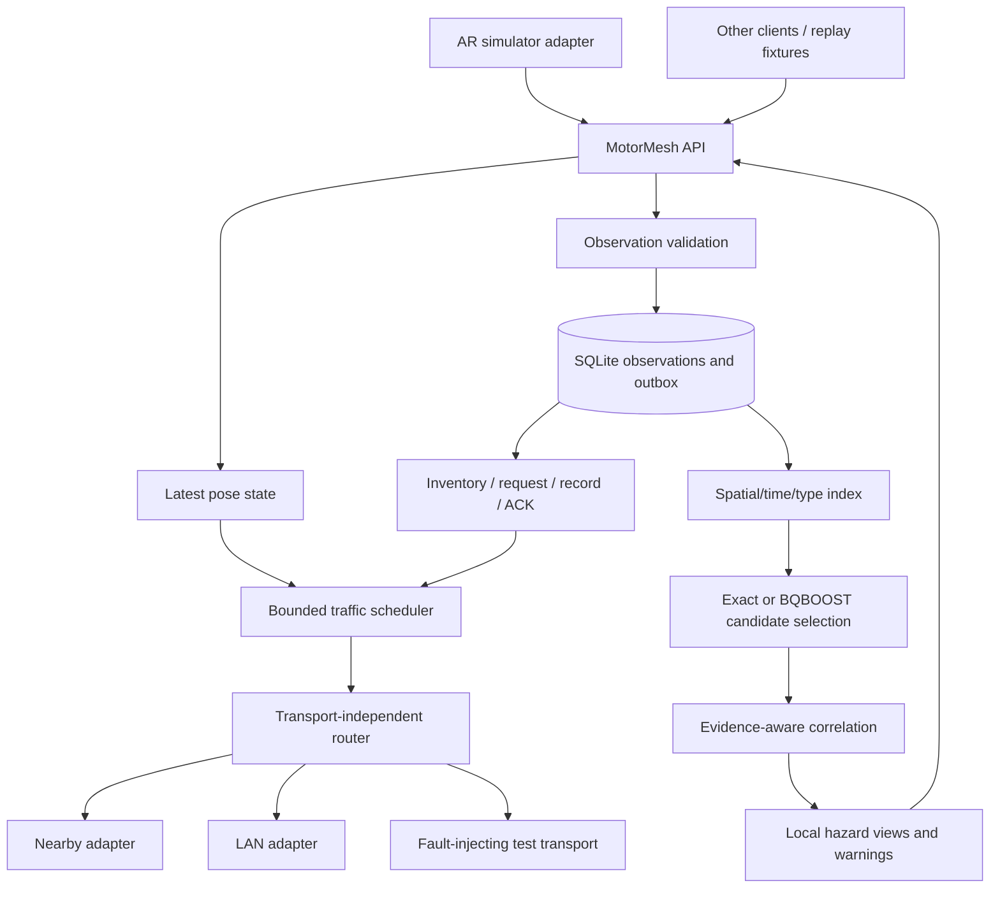

# ResiLane — Architecture and simulation integration handoff

Status: **proposed architecture and feed contract, revision 2**, updated 9 October 2026 against the local simulator source. Prepared for the user to send to Astra for senior review. **Astra has not reviewed this file.** This is one self-contained Markdown handoff; Part A contains the architecture and Part B contains the exact simulation feed contract.

## Review brief for Astra

Review the design for distributed-systems correctness, Android feasibility, security, performance isolation, and integration with the current ResiLane simulator. Distinguish existing implementation from proposed work, and distinguish source inspection from measured results. Return prioritized findings with section references, a concrete failure scenario and a recommended correction. Do not implement or redesign the simulator UI.

The intended outcome is an offline three-phone demonstration with real shared-frame pose exchange, controlled A → B → C application forwarding, durable hazard observations, reconnection reconciliation and an exact candidate-retrieval baseline. BQBOOST is an optional accelerator for segregating candidates among chaotic events; it is neither a router nor a truth/identity verifier.

Review especially:

1. Independent camera orientation and vehicle heading: shared-frame conversions, initialization/latching, interpolation, heading provenance and tracking-session resets.
2. Frame/session/epoch compatibility; expiry and replay under clock uncertainty; original last-good capture time during tracking loss.
3. Store-carry-forward and bounded reconciliation: immutable observation IDs, ACK semantics, tombstones, partitions, storage limits and convergence assumptions.
4. Offline enrollment, origin authentication, signature serialization and replay limits; distinguish hostile nodes from ordinary packet loss.
5. Scheduling under Android/Nearby buffering and CPU pressure; pose latency must remain isolated from retrieval, image inference and durable synchronization.
6. Perception provenance: synthetic remote cars, render-style changes, asynchronous capture alignment, Bitmap ownership and prevention of evaluation-truth leakage.
7. Whether the exact-grid/time/type baseline should remain the only retrieval implementation until BQBOOST demonstrates candidate recall and total-cost benefit.

## What changed in the ResiLane simulator

The working tree has no commits, so there is no reliable commit-to-commit change boundary. These are differences identified relative to the earlier architecture, using the current local source. Source fingerprints at the end make this inspection reproducible; file links resolve in the current project layout.

| Current source behavior | Consequence for this revision |
|---|---|
| `HeadingControl` accepts a screen-relative joystick and stores yaw in the tracking frame; position still comes from tracking. | Vehicle heading, camera quaternion and camera ground-view direction are three distinct values. Forward them without forcing equality. |
| `SimEngine.broadcast` sends the camera quaternion and `lastYaw` together in the existing `PoseMsg`. `Snapshot` separates `myYaw`/`myHeadingDeg` from `myViewYaw`. | The existing binary layout did not change; its yaw semantics now require an explicit adapter mapping and heading-source metadata. |
| Default rendering is a hologram car; realistic PBR is selectable. The GL surface also includes a ground grid when enabled. | Add capture-time render style, placement mode and render-profile/config revision; stratify perception evaluations by style. |
| Ground-locked placement uses relayed yaw. Free 3D placement derives orientation from the camera quaternion and ignores yaw. | Record the applied model pose and placement mode in evaluation truth; do not claim the modes have identical orientation behavior. |
| `FeedSample` still combines detections, truth and borrowed Bitmap data without the new contract fields. | Timing, ownership, alignment and perception/truth separation remain required integration work. |
| Orientation-only fallback still assumes eye height and has no shared translational frame. | It cannot satisfy the physical walking-position demo; use an explicitly labelled orientation or scripted demonstration if necessary. |

### Source inconsistencies and open integration decisions

- **Heading before the first stick input:** the README says the camera controls heading until the stick is first touched. In the current `HeadingControl.update`, the first update initializes `trackingYaw`, and later updates inside the deadzone keep it latched. `SimEngine.updateHeading` resets on every frame only when joystick heading is disabled. The architecture follows the code and flags the intended startup behavior for the simulator owner to resolve. Existing `HeadingControlTest.firstFrameFacesTheCamera` checks the first frame, not subsequent untouched frames.
- **Free 3D versus joystick:** the new README heading discussion is broad, but `VehiclePlacement.place` applies yaw only in Ground Locked. The proposed contract preserves both values and records the actual placement mode; deciding whether Free 3D should change belongs to the simulator owner.
- **Dataset heading names:** `DatasetWriter.poseJson(myWorld).heading_deg` derives camera-forward heading. `vehicles[].heading_deg` comes from each vehicle's yaw. They currently describe different things under the same leaf name. An export adapter must explicitly name camera and vehicle fields and carry projection method/provenance; it must not interpret the local camera heading as joystick heading.
- **README field trial C:** it still says turning the phone turns the car. Under a latched joystick heading that is no longer the expected Ground Locked behavior. Run separate view-follow and latched-heading scenarios.
- **Timing and ownership:** `FeedSample.timeMs` is still inference-completion wall time, PixelCopy alignment remains unproven, and the Bitmap is recycled after callbacks. Render style/control mode metadata are proposed additions, not fields already present in `FeedSample`.
- **Heading reset:** no automatic heading reset is evident in `SimEngine.attachSession`. The integration must reset tracking-frame control state when a tracking session is replaced; a shared-frame recalibration is handled by transforming the existing latch into the new shared coordinates.

This revision modifies documentation only. It does not change the simulator implementation, execute application tests, certify hardware support, or claim any performance target has been achieved. Existing tests were inspected for coverage, not run. No file has been sent to Astra or another person.

---

## Part A — Distributed architecture

Status: proposed implementation specification, 9 October 2026. This document describes the target system; existing code is identified explicitly. No claim of implemented security, device performance, or completed integration is implied.

ResiLane is the product. MotorMesh is the working name of its reusable networking and distributed-knowledge subsystem. The AR simulator is one client. Ground Zero Mesh supplies implementation patterns and selected components; V2X Swarm Intelligence supplies traffic scenarios and evaluation ideas; BQBOOST supplies candidate retrieval over encoded observations.

Part B of this same document defines what the ResiLane simulator publishes and receives, with current source mappings and a concrete integration checklist.

### 1. Decisions and scope

1. Use a Kotlin/JVM domain core with Android adapters. Domain types contain no ARCore, Unity, Bitmap, View, or Google Play Services types.
2. Adapt Ground Zero Mesh's transport interface, relay behavior, simulation transport, and reconnection patterns. Its rescue envelope, incident semantics, and application singleton need redesign before reuse.
3. Use Nearby Connections P2P_CLUSTER for the first three-phone radio demonstration. Provide a LAN socket adapter and a deterministic virtual transport for reproducible tests.
4. Maintain separate delivery policies for poses and knowledge. Poses are latest-value state; observations are durable immutable records with expiry.
5. Use SQLite for durable observations and synchronization state on Android, behind a JVM storage interface. Use an in-memory implementation in deterministic tests.
6. Use spatial/time/type filtering followed by exact candidate comparison as the reference implementation. Add BQBOOST to narrow large candidate pools. Candidate selection never establishes identity, independent evidence, or verification by itself.
7. Preserve origin signatures across forwarding. Authenticated links, replay checks, admission limits, and evidence lineage have distinct responsibilities.
8. Keep rendering, calibration estimation, sensor acquisition, and model training outside the networking core. No vehicle actuation is part of the three-phone demonstration.

The runtime requires no remote application server for ordinary discovery, pose exchange, event propagation, or reconciliation. A phone hotspot/access point may carry local packets; it does not become a knowledge authority. Google Play Services remains a platform dependency of the Nearby adapter.

### 2. Evidence from the current code

Source inspection is a point-in-time record. Another agent is editing ResiLane concurrently; the integration owner must reconcile changes at the named interfaces.

| Source | Existing capability | Architectural consequence |
|---|---|---|
| `core/.../proto/Protocol.kt` | Little-endian v1 envelopes; origin, message sequence, hop TTL; pose, hello, ping/pong, scale, bye | Preserve the old decoder only in a compatibility adapter. Introduce an explicitly versioned MotorMesh protocol. |
| `core/.../sync/Sync.kt` | Clock-offset estimation, pose buffering/interpolation, node liveness | Reuse interpolation after adding session/frame isolation and stale-update rejection. |
| `core/.../frame/SharedFrame.kt` | Shared marker-derived metric frame | Carry an explicit shared frame descriptor; a local calibration counter does not identify it. |
| `app/.../ar/SimEngine.kt` | Shared-world camera pose, independent vehicle yaw, rate-limited broadcast, ARCore and orientation-only fallback | Feed physical camera pose and vehicle heading separately, before rendering offsets/scales. Orientation-only fallback cannot publish measured translation. |
| `core/.../control/Heading.kt` | View-relative steering; tracking-frame heading latch; shared-world conversion | Preserve controlled vehicle heading separately from camera orientation and motion direction. Expose heading provenance. |
| `core/.../sync/Sync.kt::VehiclePlacement` | Ground-locked placement uses yaw; Free 3D derives orientation from camera quaternion | Carry render mode in evaluation metadata; do not infer identical orientation semantics across modes. |
| `app/.../ar/Snapshot.kt` | Render-facing state, distances, screen boxes, speed and capability mode | Extract a transport-independent DTO. Do not publish the entire render snapshot. |
| `app/.../vision/VisionPipeline.kt` | `FeedSample`, `FeedSink`, YOLO results and simulator truth, dataset export | Existing integration point for perception; extend timestamp, frame alignment, and memory ownership semantics. |
| Ground Zero `Transport`, `Gossip`, `StoreAndForward` | Addressed sends, peer discovery adapters, bounded seen cache, hop relay, in-memory reconnect replay | Best mesh foundation; requires global resource bounds, durable records, authentication, and a generic payload model. |

Important limitations confirmed in inspected code:

- ResiLane v1 has no shared coordinate-frame ID or authenticated origin session. Its replay window treats sufficiently old sequences as a possible restart; this is not secure replay protection.
- Ground Zero's `NodeId` is a random 48-bit label, not a cryptographic identity. Nearby auto-accept is explicitly unauthenticated at the application enrollment level.
- Ground Zero's outbox is a `ConcurrentHashMap`, with 128 entries per zone bucket and a 15-minute TTL. It is not a disk-backed event store; per-bucket limits are not a global memory bound.
- Ground Zero deduplicates incidents by origin plus incident timestamp. Its propagation key contains selected mutable fields. MotorMesh must identify complete immutable records so changes to coordinates, evidence, or other fields cannot disappear from synchronization.
- Ground Zero counts distinct relayers as corroborating testimony. MotorMesh must separately count independent observations; several relays carrying one report remain one evidence source.
- Current vision samples use inference-completion wall time and recycle the Bitmap after sink callbacks. PixelCopy runs asynchronously; exact association with the requested render frame must not be assumed.

### 3. Modules and dependencies

These are logical boundaries; they may initially share a small number of Gradle libraries. Avoid adding a build module solely for every class.

| Module | Owns | Depends on |
|---|---|---|
| `motormesh-api` | IDs, coordinates, DTOs, publisher/subscriber interfaces, result codes | JVM standard types |
| `motormesh-core` | Admission, membership, scheduler, routing, dedupe, session/frame state, event sync | API; injected clock, transport, storage, identity |
| `motormesh-storage-android` | SQLite schema, transactions, recovery, retention, migrations | API/storage interfaces; Android database APIs |
| `motormesh-transport-android` | Nearby discovery, authenticated enrollment callbacks, permissions, lifecycle, link metrics | Transport interface; Android/Nearby |
| `motormesh-transport-lan` | Framed socket connections, authenticated TLS links, reconnect, topology controls | Transport interface; standard TLS/socket provider |
| `motormesh-security-android` | Keystore identity, COSE signing/verification adapter, pinned membership | Security interfaces; maintained COSE/provider libraries |
| `motormesh-retrieval` | Grid/time/type index, exact candidates, correlation policy | Observation/query API; read-only snapshots |
| `motormesh-bqboost` | Native kernel adapter, index snapshots, row-ID mapping, retrieval metrics | Retrieval interface; pinned native C ABI; JNI |
| `resilane-sim-adapter` | Simulator DTO mapping, lifecycle events, remote-pose callbacks | MotorMesh API and simulator; owned integration boundary |
| `motormesh-testkit` | Fake clock, fault-injecting links, trace replay, generated event scenarios | API/core; no Android requirement |

Runtime state belongs to an explicit `MotorMeshRuntime` instance, not an application-wide static singleton. An Android service can own one instance; tests can instantiate many. Callback subscriptions return disposable handles. A failed transport must not terminate the store or another transport.



Inbound transport data passes length/rate checks, signature/session checks, expiry checks, and deduplication before it enters state or storage. Retrieval and database workers never execute on the renderer thread.

### 4. Identities, sessions, clocks, and coordinates

#### Identity and restart model

- `node_id`: SHA-256 fingerprint of the identity public key encoded as DER SubjectPublicKeyInfo. Use the full digest on the wire; human labels are separate.
- `network_id`: UUID identifying the enrolled demonstration/fleet group. It scopes membership and prevents accidental joining of unrelated demonstrations.
- `origin_session_id`: fresh UUID for each runtime start, with a signed descriptor carrying a durable monotonically increasing `session_generation`. Increment/persist the generation before transmitting.
- `stream_id`: identifies a producer stream, such as the physical pose stream. Virtual actors use separate actor/stream IDs under their real producer's identity, never fabricated trusted device identities.
- `message_id`: random UUID for each immutable originated message. Relays preserve it.
- `observation_id`: random UUID allocated once per immutable observation; retries reuse it. A new observation/retraction gets a new ID and may reference an earlier one.
- Sequence numbers are nonnegative 64-bit integers per stream/session. JSON debug exports encode 64-bit values as decimal strings to avoid JavaScript precision loss.

Persist the highest accepted session generation for each enrolled node. Delayed poses from older generations cannot reactivate a retired session. Historical signed hazard observations may remain valid after the origin starts a new session; pose-session retirement must not delete them. An application data reset that loses the generation counter must rotate identity and re-enroll.

#### Time

Every local acquisition records monotonic time and an accompanying UTC estimate with uncertainty. Monotonic counters from different phones are incomparable until a session-specific clock mapping is established.

Use a four-timestamp exchange to estimate peer offset, delay and uncertainty. Keep short rolling samples and prefer low-delay samples; never label an RTT/2 estimate as measured one-way latency without reporting its assumptions. Invalidate mappings on origin-session changes and local clock discontinuities.

Network lifetimes are signed `created_at_utc_ms`, `expires_at_utc_ms`, and `max_age_ms`. Relays preserve these. Queue residence and local aging use monotonic time. On reception compute a conservative age interval using clock uncertainty; accept for an active warning/pose only when the oldest plausible age fits the validity limit. Large or unknown skew produces `TIME_UNCERTAIN`, not silently fresh data. Such observations may be retained in a bounded quarantine but are not forwarded as current hazards.

For the demonstration, provision approximately aligned device clocks during setup and record uncertainty. No Internet clock service is required during operation. After a reboot that prevents reconstructing safe age, re-establish time confidence before reactivating persisted records. No receiver or reconnect may extend an origin's expiry.

#### Spatial scopes

Use a discriminated position union:

- `SHARED_LOCAL`: shared `coordinate_frame_id`, `frame_revision`, `(x,y,z)` in meters and uncertainty. Frame descriptor includes marker asset digest, physical marker width, ground origin/height convention, axes, and run identity.
- `WGS84`: latitude/longitude in degrees, accuracy in meters, altitude plus an explicit datum if available. Use geodesic distance, with a documented projection if an index uses a local planar approximation.
- `UNLOCATED`: a valid observation without a spatial estimate; it cannot satisfy a nearby-radius query.

The same printed marker used in different rooms must get different run/frame identities. A static marker digest alone is insufficient. All devices receive the same frame descriptor, e.g. through a setup QR/config manifest. The device distributing the manifest is not required to remain online.

Each `(coordinate_frame_id, frame_revision)` identifies one immutable shared descriptor, bound to its content digest in the authenticated setup manifest. Producer-local calibration epoch, calibration status, and measured quality are separate mutable state. Quarantine conflicting shared descriptors. An unknown descriptor may trigger a bounded descriptor request; discard its poses until an accepted descriptor exists, and never render them under a guessed frame.

ResiLane's existing shared frame is right-handed: +Y up, +X along the projected marker edge, +Z = X cross Y. The origin is the marker center adjusted by configured marker height. Quaternion order is `(x,y,z,w)` and maps display-oriented camera-local vectors into shared-world vectors. Camera forward is local `(0,0,-1)`.

`heading_rad` is the **vehicle's intended heading**, independent of the camera quaternion. It is measured from world -Z toward +X in `[0,2π)`. Convert the current `PoseMsg.yaw` with `normalize_0_2pi(atan2(sin(yaw), -cos(yaw)))`; existing yaw is measured from +Z. Never overwrite joystick heading with a value derived from the camera quaternion. Carry `heading_source` and `heading_valid` with it.

Optional `camera_ground_heading_rad` describes the viewing direction and must state its projection method. A direct horizontal camera-forward projection is undefined when near vertical. The current `HeadingControl.groundForwardYaw` instead blends camera forward with screen-up while looking down; label that method `SCREEN_UP_BLEND_V1`. A valid joystick latch can retain vehicle heading while the phone looks vertically down. Neither heading implies velocity direction or physical vehicle steering.

Distinguish:

- `frame_revision`: changes when the agreed coordinate meaning changes or the marker moves.
- `calibration_epoch`: a producer-local revision when its estimate of the same frame changes. Peers need not have equal epochs. Clear that producer's interpolation and derivative history on an epoch change.
- `origin_session_id`: runtime identity, unrelated to the coordinate frame.

Do not silently reproject stored hazards after recalibration. Preserve their original frame/epoch/uncertainty. If their localization is no longer trustworthy, retire or replace them with linked observations. Cross-frame transformations are an explicit future API with provenance and uncertainty.

### 5. Transport and membership

#### Transport choice

| Transport | Role in ResiLane | Constraints |
|---|---|---|
| Nearby P2P_CLUSTER | Primary three-phone offline adapter; already used by both projects | Google Play Services and runtime permissions; authenticate enrollment; validate actual hardware behavior. |
| Local Wi-Fi/hotspot sockets | Repeatable addressed topology and diagnostics; use standard authenticated TLS | Requires local network reachability; AP/client isolation may block peers. A hotspot owner is a radio dependency. |
| Raw UDP broadcast | Existing diagnostic/legacy compatibility path | No confidentiality/authentication by itself, no reliable delivery, poor topology control. Disable it for secure and forced-chain trials. |
| Wi-Fi Direct | Future platform adapter when direct control is justified | Group ownership and reconnection require device testing; a radio group is not an application routing protocol. |
| Wi-Fi Aware | Optional capability-selected adapter | API/hardware availability must be queried; support on the actual phones is unknown. |
| Bluetooth/BLE | Primarily delegated to Nearby initially | Dedicated adapter only if measured requirements justify its payload/throughput limits. |
| LoRa bridge | Future low-bandwidth hazard summaries | No realtime pose stream; do not force the whole protocol into Ground Zero's LoRa envelope size. |

Nearby documents offline exchange and cluster strategies. Device radio selection remains platform-controlled; do not promise a particular radio for each link. See [overview](https://developers.google.com/nearby/connections/overview) and [strategies](https://developers.google.com/nearby/connections/strategies). Wi-Fi Aware support and availability are distinct checks: [Android guidance](https://developer.android.com/develop/connectivity/wifi/wifi-aware).

A July 2026 Android announcement schedules a late-2026 change: Nearby will stop automatically enabling radios. Expose `RADIO_DISABLED` and let the app request that the user enable the required radio; do not rely on automatic toggling. [Official announcement](https://android-developers.googleblog.com/2026/07/upcoming-changes-nearby-connections-api.html).

#### Required transport interface

Extend Ground Zero's addressed byte transport with observable outcomes:

```text
start(config) / stop()
peerEvents() -> discovered | connecting | authenticated | disconnected | failed
send(peerId, bytes, trafficClass, deadlineMono) -> accepted | backpressured | unavailable
receivedFrames() -> peerId, linkSessionId, bytes, receivedMono
capabilities() -> maxFrameBytes, supportsPriority, observedLinkType
linkMetrics() -> queueBytes, payloadCompletions, failures, reconnects
```

Transport acceptance means queued, not delivered or committed. Database ACKs are separate. Bind endpoint IDs to enrolled node IDs only after authentication. Both sides use a deterministic dial rule to reduce simultaneous connection attempts, with bounded retry and jitter (1, 2, 4, 8, then 30 seconds maximum). Link disappearance is ordinary disconnection; it does not penalize factual trust.

Use explicit states `DISCOVERED -> CONNECTING -> AUTHENTICATING -> CONNECTED -> SUSPECT -> DISCONNECTED`. Send lightweight heartbeat every 2 seconds while foreground operation is enabled; suspect after 6 seconds, disconnected after 15 seconds or transport notification. Pose freshness uses much shorter timers and must not wait for membership timeout.

#### Multi-hop definition and proof

For the physical chain trial, allow direct application links A-B and B-C only. Reject A-C discovery/connect attempts at both adapters, disable UDP and other parallel routes, and log the active peer sets. All three phones may still be within radio range; this proves application relay, not a measured radio-range extension.

Run C-to-A as well as A-to-C. Stop B: cross-chain delivery must stop. Restart/reconnect B: unexpired durable events must reconcile; old poses must not replay. Separately test actual physical range obstruction if a radio-range claim is desired.

Ground Zero's multi-process TCP chain is valuable protocol evidence, but does not replace the three-phone radio trial.

### 6. Wire protocol, forwarding, and scheduling

Use a new protocol name/version (`resilane.mesh`, major 1); do not reinterpret the existing ResiLane `RL` v1 datagram as a secure MotorMesh record. Negotiate major/minor versions and capabilities at connection establishment; reject incompatible major versions.

Use deterministic CBOR for the signed payload representation and a maintained COSE implementation for `COSE_Sign1`. JSON is a human-readable trace/export representation only. Reject duplicate map keys, non-finite values, oversized lengths, unsupported critical fields, and excessive nesting. Pin library versions and cross-platform encoding fixtures before shipping. [CBOR RFC 8949](https://www.rfc-editor.org/rfc/rfc8949.html), [COSE RFC 9052](https://www.rfc-editor.org/rfc/rfc9052.html).

```text
Immutable signed origin record:
  protocol/version, network_id, origin_node_id, origin_session_id,
  session_generation, stream_id, sequence_number, message_id, kind,
  created_at_utc_ms, expires_at_utc_ms, max_age_ms, max_hops,
  payload_schema_version, payload

Per-link forwarding wrapper:
  origin_record_bytes, hops_travelled_before_this_link,
  optional diagnostic relay IDs (bounded)
```

Origin sends with `hops_travelled_before_this_link = 0`. Receiver increments it by one to obtain received link count. Deliver only if that count is at most signed `max_hops`; relay only if smaller, setting the outgoing wrapper to that count. A default `max_hops=4` permits four links. Stored copies preserve consumed hops and signed lifetime. Diagnostic relay IDs are not independent evidence or cryptographic path proof.

The forwarding wrapper is mutable. A compromised relay can lie about path length. Hop limits constrain honest forwarding; signed expiry, local dedupe, enrollment, and byte/rate limits bound abuse. Do not claim that an unsigned hop counter resists malicious reset.

Message kinds:

| Kind | Policy |
|---|---|
| `HELLO`, `SESSION_DESCRIPTOR`, `FRAME_DESCRIPTOR`, `HEARTBEAT`, `TIME_PROBE` | Small bounded control traffic; no durable hazard record |
| `POSE`, `TRACKING_STATUS` | Latest value; short expiry; no ACK/retry backlog |
| `OBSERVATION`, `RETRACTION`, `ASSESSMENT` | Durable signed records; retry and reconcile while valid |
| `INVENTORY_PAGE`, `WANT`, `RECORD_BATCH`, `COMMIT_ACK` | Bounded durable synchronization, scheduled below realtime/control |
| `EVIDENCE_REQUEST`, `EVIDENCE_CHUNK` | Opt-in, rate-limited bulk transfer; disabled by default in the demo |

#### Baseline routing

1. Validate limits, enrollment, signature, session applicability, time and spatial/network scope.
2. Deduplicate immutable record identity/hash. Same ID with different bytes is a conflict and must be quarantined, never silently overwritten.
3. Deliver to the appropriate state path; durably commit event records before ACK.
4. Relay an eligible event once to each eligible connected peer except the ingress peer, within hop/lifetime/budget limits. Track bounded per-peer delivery state.
5. Retry durable peer transfers with backoff; retry timeout or ACK loss must never generate a new observation ID.
6. On reconnection, exchange inventories of eligible unexpired records and fetch missing records.

For three phones, hop-limited eager event push plus reconciliation is the baseline. It is easier to validate than mobility prediction. At greater density compare fanout-limited push, subscription by spatial cells/time/type, and summary-first pull. Selective forwarding may reduce coverage; periodic reconciliation repairs missed pushes only within the same scope, hop reach, retention, and available contact duration.

Pose forwarding is separately configurable: direct-only normally; two links for the A-B-C pose trial. Forward only the freshest valid sample per origin/stream and never store it for a later reconnect. Local delivery follows latest sequence even if packets arrive out of order.

#### Queue policy

Separate control, pose, event, and bulk queues. Use weighted deficit round-robin with short control priority and reserved pose service, rather than one FIFO or unbounded strict priority. Each queue still has byte limits and deadlines. Under overload, drop expired/replaced poses first, then defer bulk and event synchronization. Do not block the GL thread or silently discard a locally acknowledged durable observation.

Transport adapters must also limit outstanding sends and bytes until transport completion, and submit durable synchronization in bounded chunks. Application queue limits alone do not bound a Nearby SDK's internal buffering. The scheduler cannot preempt an already submitted payload or assume independent radio channels for message classes. Tune chunk and in-flight budgets from device measurements; the latency figures below are targets, not hard realtime guarantees.

| Initial configurable bound | Proposed starting value; measurement required |
|---|---|
| Enrolled active peers | 16, of which 3 are used for the demo |
| Realtime pose rate | 12 Hz/device; adapt downward on sustained backpressure |
| Latest pose slots | 1 per origin/stream/egress peer; hard global limit |
| Pose validity | 500 ms from capture, including uncertainty and queueing |
| Peer rendering state | stale at 500 ms; remove/hide according to client policy by 2 seconds |
| Event hop limit | 4 links; pose 1 normally, 2 for chain trial |
| Encoded pose limit | 1 KiB including origin signature; oversize is rejected |
| Encoded event record limit | 8 KiB; large evidence stays referenced |
| Peer control/event memory budget | 32 KiB control + 256 KiB event per peer; global cap 4 MiB |
| Seen-record cache | 4,096 IDs, expiry-aware; persistent event IDs provide durable dedupe |
| Origin event rate | 5/s burst, 1/s sustained by default; scenario generators declare overrides |
| Sync page/batch | up to 128 ID/hash entries; record batches at most 32 KiB |
| Durable metadata store | 10,000 active observations or 64 MiB, whichever is reached first |
| Evidence cache | separate 32 MiB cap; off-network by default |
| Candidate query worker | 1 worker initially, cancel superseded requests |

Explicitly cap origin/session/frame metadata, quarantine, tombstones, and spatial cells too. At capacity, expire eligible data and evict by documented retention policy; return `CAPACITY_REJECTED` if durable admission cannot be honored. Any deliberate retention loss sets a metric and weakens convergence guarantees. These are defaults for development, not measured device capacities.

### 7. Realtime pose state

The producer supplies a tracked pose and quality, or a status event explaining why pose is unavailable. MotorMesh stamps identity, signs asynchronously, and replaces a pending older pose. Samples may be dropped before transmission but sequence numbers never move backward.

Receiver state is keyed by `(node_id, actor_id, origin_session_id, coordinate_frame_id, frame_revision, calibration_epoch)`. Session retirement and frame compatibility are checked before the sample reaches the client. A late sample can optionally populate a bounded interpolation history only if it cannot replace latest state or cross an epoch boundary; the initial implementation simply drops older sequences.

Callbacks provide raw admitted poses, mapped local capture time, uncertainty, received age, source type, and quality. ResiLane performs interpolation. Keep 24-48 admitted samples at most, flush on epoch/session/frame changes, and hold rather than extrapolate when tracking degrades. Mark held state with its original capture age; republishing a held pose does not make its position newly observed.

Position is the shared-frame camera/device position. `orientation_xyzw` remains the display-camera-to-world quaternion; `heading_rad` independently carries the vehicle heading plus control provenance. Clients must preserve both through forwarding and interpolation; use circular interpolation for headings across 0/2π. The quaternion and vehicle heading need not agree. Reset or remap heading history on tracking-session/frame/calibration discontinuities; a shared-frame recalibration must convert the tracking-frame latch using the new transform. Model scale, cockpit overlay, car offset and ground locking remain rendering settings. If future clients need a vehicle body origin, provide an explicit calibrated rigid transform and separate physical dimensions; a visual scale slider is not that transform.

### 8. Distributed hazard knowledge

#### Immutable observation versus local hazard view

```text
Observation:
  observation_id, origin_node_id, origin_session_id, origin_sequence
  source_kind: manual | sensor | perception | scripted_simulation
  observed_at, time_uncertainty, expires_at
  event_type, severity_claim, confidence, confidence_kind
  position: SHARED_LOCAL | WGS84 | UNLOCATED
  localization_method, position_uncertainty_m
  evidence_refs[], parent_observation_ids[], evidence_lineage_id
  detector/model/feature_schema versions if applicable
  source_frame_id and calibration_epoch when applicable
  signature and signed content hash

HazardView (derived locally):
  local_cluster_id, member_observation_ids, spatial/temporal extent
  type_distribution, active_severity, independent_source_count
  evidence_status, disputed, expires_at, policy_version
```

`severity_claim`, detector score, signature validity and verification status are different fields. An authenticated node can be wrong. A signature authenticates bytes and origin; it cannot prove a pothole exists.

Statuses: `REPORTED`, `CORROBORATED`, `VERIFIED_BY_POLICY`, `DISPUTED`, `EXPIRED`, `RETRACTED`. A `VERIFIED_BY_POLICY` assessment records the named policy, version, supporting observations, and issuer; receivers can independently reject it. There is no majority vote that creates truth.

Two independently produced observations may corroborate if they satisfy the policy's time, location, evidence and source-independence requirements. Reports derived from the same image/frame, imported feed, earlier observation, or relayed packet share lineage and count once. Distinct keys alone do not prove independent sensors or defeat Sybil behavior.

#### Local create and warning path

Validate and sign a submitted observation; commit it and its synchronization eligibility in one SQLite transaction; then emit the local update and schedule forwarding. A high-severity local report can produce a provisional warning immediately after validation/commit. BQBOOST, embedding generation and evidence transfer are never prerequisites for initial warning or relay.

Run candidate matching asynchronously, update the derived hazard view, and reconcile existing warning IDs. Exact observation IDs suppress transport duplicates. A persistent alias/member mapping links observations already presented as one warning. When clusters merge, migrate warning state to a surviving local ID without replaying the same alert. If clusters split after expiry or retraction, apply a cooldown and severity-change rule rather than silently reusing an unrelated warning.

Warn again only for a materially higher severity, meaningful renewed observation after cooldown, or a changed route relevance policy. The three-phone baseline uses radius and time; road direction and lane relevance require the optional traffic feed.

#### Persistence and reconciliation

SQLite logical tables:

- `observations`: immutable signed bytes, content hash, event ID, origin, scope, expiry, position and indexed type/time fields.
- `record_links`: parents, evidence lineage and supersession/retraction links.
- `evidence_refs`: local handle/hash/type/size and availability; no receiver-readable meaning is assigned to a sender's local path.
- `assessments`: signed policy assessments; derived views may be rebuilt.
- `peer_sync`: scoped cursors, missing IDs, outstanding transfer/ACK state.
- `sessions_and_keys`: pinned membership, session generations, revocations.
- `warning_state`: presented member IDs/aliases, severity and cooldown.

Use transactionally consistent, paged inventories of `(observation_id, content_hash)` for a frame or geographic/time scope. Receiver sends `WANT`, sender sends bounded record batches, receiver verifies and commits, then sends `COMMIT_ACK`. ACK means durable acceptance, not corroboration or global delivery. Bloom filters may be an optimization later; the baseline exact inventory avoids false-positive omissions. Persist peer sync progress but allow safe full resumption after a lost cursor.

Origin-authorized retractions reference exact observation IDs. Another node may submit contrary evidence but cannot delete the origin's record. Retractions propagate as durable records and survive until all referenced records would have expired plus the accepted clock-skew allowance. Enforce an upper record lifetime (initially 24 hours); tombstones must not disappear while an eligible target can be resurrected. Expiry excludes records from active queries immediately; disk reclamation is asynchronous.

Road hazard lifetimes are type-specific policy: temporary braking seconds, obstruction minutes, infrastructure defect longer with revalidation. A demo default of 120 seconds is configurable and is never silently treated as a real-road safety policy.

Within admitted size limits, compatible scopes, remaining hop reach, retention and sufficient contact time, nodes reconcile the same immutable record set despite duplicates and reordering. Local hazard assessments can differ by policy, time, trust or available evidence. Cluster IDs and warning history are local, not network consensus identifiers.

### 9. BQBOOST candidate segregation

This stage directly addresses the user's intended role: reduce a large, chaotic collection of observations to a manageable candidate set for correlation and relevance checks.

```text
New observation / nearby-events query
    -> network/frame or geographic scope
    -> unexpired time window and compatible event classes
    -> spatial candidate cells + exact radius/uncertainty gate
    -> exact scan OR BQBOOST coarse vector candidates
    -> precise feature/semantic rescoring
    -> temporal/geometric/evidence-lineage checks
    -> related-event suggestions or local cluster update
```

The local `RAGS/bq-rag-perf/bqboost` implementation exposes sign/top-k encoding, Hamming/overlap search, float and INT8 rescoring, and hardware policy APIs. The Vault-packaged kernel is a smaller, distinct snapshot; do not assume ABI parity.

Define `CandidateIndex.upsert(recordId, encodingId, vector)`, `remove(recordId)`, and `search(query, eligibleIds, k, budget)` with an exact implementation and a BQBOOST implementation. The existing native kernels scan arrays; they do not accept arbitrary event predicates. Therefore build eligible compact shards or remap an eligible candidate matrix before native search, and measure that cost. Searching globally then filtering top-k can miss all relevant local events and is not the baseline design.

Use two representation options under separate encoder IDs:

1. Structured normalized features: event category, relative spatial/time relationships, duration, motion residuals, object properties, and explicit missing-value indicators. Fit normalization on training data and freeze it for evaluation.
2. Text embeddings for descriptions, using the same pinned encoder/model on all compared rows. Local embedding generation is optional; a raw description is not a vector.

Neither the detector's class confidence nor an arbitrary sensor vector automatically defines a useful similarity metric. Evaluate each representation. Never mix dimensions, normalization, model versions or sign/overlap code types in one index. Persist original observations as the source of truth; index snapshots are rebuildable caches with immutable row-ID maps and generation IDs. Publish a rebuilt index atomically; queries must not observe partial updates or freed native buffers.

For D-dimensional sign codes, raw code storage is `8 * ceil(D/64)` bytes per row; at D=384 this is 48 bytes. Add original vectors or INT8 rows/scales, ID maps, scratch, JNI copies and index metadata to actual RSS. Float 384-dimensional rows alone add 1,536 bytes per row. BQBOOST is a scan accelerator, so candidate preprocessing and memory bandwidth still matter.

Start with exact search at small pool sizes. Benchmark pools of 100, 1k, 10k and 100k synthetic/recorded events; large tests may exceed the demo store and run as standalone retrieval benchmarks. Sweep k and candidate depth, measure recall of true matching incidents, false-merge rate, p50/p95/p99 latency, peak RSS, energy/thermal behavior and pose impact. Include identical wording for different hazards, different wording for one hazard, overlapping roads/altitudes, recycled evidence, frame changes, missing fields and near-duplicate bursts.

Proposed enablement gate: at least 99% recall of labelled match candidates at the selected k, no increase in unsafe false merges under the downstream policy, and a material end-to-end latency or memory improvement over exact search including embeddings/filtering/JNI. This is a target, not a result. Missing an approximate candidate cannot delete an observation, suppress its initial warning, or change its authenticity.

### 10. Integrity, enrollment, and trust

Threats considered: accidental packet loss/reordering, spoofed endpoint names, message alteration, old-message replay, unauthenticated floods, enrolled nodes submitting false observations, repeated evidence dressed as independent reports, and malicious forwarding behavior. Radio jamming and physically compromised sensors are not solved by this protocol.

For the demo, enroll exactly the participating identities through an operator-verified manifest/key fingerprints. Use Nearby authentication-token confirmation for enrollment and bind the public key received on that verified link to the pinned node identity. Do not authorize enrollment by matching service ID, endpoint name, QR run ID, or a self-signed message alone. [Nearby authentication guidance](https://developers.google.com/nearby/connections/android/manage-connections).

Use platform-supported ECDSA P-256/SHA-256 identity keys and standard COSE ES256 origin signatures. Android private keys live in Keystore where supported; record actual backing/security level rather than asserting hardware protection. Signing/verification runs on bounded workers. [Android Keystore](https://developer.android.com/privacy-and-security/keystore).

All relayed poses and event records retain verifiable origin signatures. Direct Nearby links supply transport encryption; LAN adapters require a maintained standard TLS implementation with pinned peer certificates/keys. Forwarders can read the hazard metadata; end-to-end secrecy from admitted relays is not part of the demo. Do not invent an encryption or key-exchange protocol.

Bound signature verification work before allowing parsing/crypto floods. Allowlisted identity count, frame lengths and input rate limits precede expensive work. Dedupe must not mark an unauthenticated claimed ID as accepted, or an attacker could suppress the legitimate record. Replay checks use signed network/session/sequence/time plus persistent event identity. Never reset replay history merely because a sequence number is old.

Local key revocation blocks new transport admission and new records, with an explicit policy for historical records. Offline revocation cannot propagate instantaneously through a partition. Trust scores only affect assessments/ranking; connectivity loss, relay count or majority repetition cannot authenticate a claim. Record inconsistent signed claims as evidence rather than importing Ground Zero's rescue severity penalty directly.

### 11. Android execution and failure behavior

Use a lifecycle-owned foreground runtime while a user-enabled session is active, with the permissions/service types required by the device OS and target SDK. Final Android manifest integration belongs to the simulator owner. Background discovery, battery restrictions and screen-off behavior require physical validation.

Execution domains: network/router actor, one SQLite writer, bounded crypto workers, one retrieval worker, and client callbacks delivered on a configured executor. No GL/main-thread disk I/O, key operations, model inference, network waits, or candidate scanning.

| Failure | Required behavior |
|---|---|
| Tracking lost | Publish status; keep original last-good capture timestamp; remote pose expires normally. |
| ARCore unavailable | Orientation-only or explicitly scripted source; no measured translation claim. |
| Recalibration | Atomically advance local epoch; clear interpolation, velocities and pending old poses. |
| Link loss/partition | Discard queued poses; retain eligible durable observations; reconnect with backoff. |
| App/process death | No historical pose replay. Recover committed records/outbox and identity generation safely. |
| Storage full | Explicit durable-write rejection; no false successful ACK. |
| Bad/huge/malformed record | Reject with reason and bounded diagnostics; no crash or unbounded allocation. |
| BQBOOST failure or missing ABI | Exact candidate fallback; observations and relay remain available. |
| Clock jump/unknown age | Invalidate time mapping; mark uncertain, suppress fresh-pose claims. |
| Different frame | Maintain membership if appropriate, but do not mix local positions or nearby queries. |
| Evidence missing | Keep observation with `evidence_available=false`; do not pretend the evidence was checked. |

### 12. V2X and distributed intelligence boundary

The inspected V2X repository models IDM following, MOBIL lane changes, beacon-assisted acceleration feed-forward, and event-driven braking/jam alerts. Its Python `World` is a simulation, not a production radio stack or evidence of safe physical control.

Adapt its scenarios into input traces and behavioral evaluations. For road-behavior experiments add velocity, longitudinal acceleration, lane/path progress, and event triggers to the simulator feed. Pose-derived phone motion alone does not justify reproducing vehicle headway/control results. A scenario may explicitly define a mapping from meters of phone movement to virtual road motion; that mapping is separate from rendering scale and must be recorded.

Distributed intelligence initially means each node forms its own hazard view from signed observations and optionally retrieved candidates. Training/model exchange is a separate future workload with its own consent, model versioning, poisoning resistance, bandwidth and evaluation. Do not carry model updates through the pose queue or count a trained model's output as independent evidence of its training samples.

### 13. Acceptance and measurement plan

The following are required future implementation checks, not tests run for this architecture document.

Before a physical-motion demonstration, verify that each of the three exact iQOO models provides working 6-DoF tracking and can join the shared calibrated frame. The current simulator README describes an iQOO 15 fallback to 3-DoF; this is a repository statement, not an independently verified device result. Orientation-only fallback cannot measure walking translation. It can support a clearly labelled orientation/network demonstration or scripted vehicle-motion feed, but it cannot satisfy the physical-motion acceptance condition.

| Scenario | Evidence and acceptance |
|---|---|
| Three phones, fully connected | Compatible poses exchanged, local vehicle excluded by client; frame and origin-session checks pass. |
| A-B-C enforced chain | Peer tables prove no A-C link; C receives A's origin-signed records through B; removing B stops cross-chain delivery. |
| Ring/diamond | Duplicate network delivery produces one stored observation and one initial warning; queues remain within caps. |
| Partition and reconnect | Independent admitted observations reconcile within eligible scopes; no stale pose replay. |
| Restart | Committed events survive; session generation advances; prior-session poses cannot reactivate. |
| Calibration/frame changes | Cross-frame updates rejected; no interpolation across local calibration epochs. |
| 3-DoF fallback | Translation unavailable; assumed eye-height position never becomes a physical hazard coordinate. |
| Spoof/tamper/replay | Unenrolled origin rejected, modified signed bytes rejected, expired/retired poses rejected. |
| Repeated evidence | Ten relays of one image remain one evidence lineage. |
| Overload | Bounded memory; nonblocking producer calls; explicit backpressure and durable admission outcomes. |
| Detector feed | Timing/box coordinate system/ownership tested; GT cannot enter the perception stream by accident; render style and grid presence accompany captured samples. |
| Independent heading | Turning the phone after a latch changes camera quaternion but preserves vehicle heading; ground-locked peer placement follows relayed heading. Free 3D retains its separately documented semantics. |
| Perception render domain | Compare realistic and hologram runs separately, including no detections; changing style cannot alter physical pose or shared-frame identity. |
| Retrieval ablation | Exact vs BQBOOST with frozen labels and representation; report candidate recall and total cost. |

Initial performance targets on the actual phones: 12 Hz local pose publication; p95 API-to-first-send below 20 ms; p95 admitted remote pose age below 200 ms direct and 350 ms over two links when clock uncertainty permits measurement; connected urgent-event propagation below 1 second p95; 100 small event records reconciled within 5 seconds after authenticated link establishment. These targets may require revision based on hardware measurements; they are not promises or safety thresholds.

Run repeatable 5-10 minute trials with cold and warmed devices, loss/reordering/delay injection, 1/3/10/30-second disconnects, background/screen-off transitions, controlled event bursts and changing frames. Record at least p50/p95/p99, drops by reason, throughput bytes, duplicate amplification, reconnection time, store sizes, RSS, thermal state and battery/energy measurement method. Report delivery ratio against records eligible for delivery, not expired records. Include clocks' uncertainty and distinguish real-radio results from virtual-network results.

Tracing fields: run ID, producer source kind, message/observation ID, node/session, sequence, frame, capture/enqueue/send/receive/commit times, hop count, link, bytes, rejection/drop reason, queue depth, candidate index generation and policy/model version. Do not log image contents or keys by default. Golden event labels used for evaluation never enter normal correlation queries.

### 14. Implementation sequence and ownership

| Step | MotorMesh owner delivers | Simulator owner delivers | Exit condition |
|---|---|---|---|
| 1. Contracts | API DTOs, validators, fake clock and in-memory transport | Shared frame descriptor and lifecycle feed; explicit modes | Both sides agree on axes/time/identity; fixture exchange succeeds. |
| 2. Pose route | Session/frame admission, latest slots, transport adapter, remote callbacks | Replace direct pose publication/receive integration at adapter boundary | Direct and forced-chain fresh poses work with interpolation. |
| 3. Hazard store | SQLite records, exact spatial query, warnings, expiry, ACK/sync | Manual/scripted hazard publication with source truth and localization | Partition/restart trials retain valid events without warning spam. |
| 4. Authentication | Enrollment, Keystore/COSE, replay and rate limits | Host enrollment/radio/lifecycle states in app | Spoof/tamper/replay acceptance checks pass before an authenticated demo claim. |
| 5. Perception feed | Safe ingest worker, localization/correlation interfaces, evidence cache | Timestamped detections, stable image ownership, alignment quality | No GT leakage, no expired Bitmap use, coordinate round-trip proven. |
| 6. Candidate acceleration | Exact/BQBOOST adapters and benchmark harness | Representative chaotic event traces and hidden labels | Candidate recall/cost gate determines whether acceleration is enabled. |
| 7. Field validation | Measured mesh/performance report | Three devices, capability checks and repeatable scenario | Full acceptance matrix with device and version details. |

Development may use isolated unauthenticated in-memory fixtures while security is built, but the field integration is not complete until step 4. Neither implementation should silently replace the other's public interfaces. One networking owner per physical link is required: running the legacy MeshRouter and MotorMesh relay over the same messages creates duplicate routing and conflicting TTL semantics.

### 15. Reuse ledger and source links

| Repository / component | Decision | Missing work / cost |
|---|---|---|
| [Ground Zero Transport](../../../ground-zero-mesh/core/src/main/kotlin/org/groundzero/mesh/transport/Transport.kt), [Gossip](../../../ground-zero-mesh/core/src/main/kotlin/org/groundzero/mesh/propagation/Gossip.kt) | Adapt narrow interfaces/algorithms and associated scenarios | Medium: generic immutable record model, explicit outcomes, scheduler, source-aware admission. |
| [Ground Zero outbox](../../../ground-zero-mesh/app/src/main/kotlin/org/groundzero/mesh/app/transport/StoreAndForward.kt), [Nearby](../../../ground-zero-mesh/app/src/main/kotlin/org/groundzero/mesh/app/transport/NearbyTransport.kt) | Adapt reconnection/radio patterns | Medium: durable/global bounds, paced inventory sync, enrollment; no whole app import. |
| [Ground Zero incident model](../../../ground-zero-mesh/core/src/main/kotlin/org/groundzero/mesh/propagation/IncidentCluster.kt) | Reference, not direct hazard identity model | Rescue severity monotonicity and relay corroboration do not establish independent road evidence. |
| [ANW gossip](../../../Autonomous-Neighbourhood-Watch-ANW-/anw/src/internal/agent/episode_gossip.go) | Reference bounded selective dissemination and tests | Kotlin policy adaptation; avoid Go agent/runtime dependency. |
| [Pramana consensus](../../../pramana/pramana/consensus.py), [mesh](../../../pramana/node/mesh.py) | Reference evidence/trust separation | Financial Python semantics do not supply peer cryptography or Android transport. |
| [BQBOOST performance C ABI](../../../RAGS/bq-rag-perf/bqboost/include/bqboost.h), [README](../../../RAGS/bq-rag-perf/bqboost/README.md) | Candidate accelerator behind a measured interface | Medium: JNI, immutable row maps, encoders, predicate sharding, quality/thermal benchmarking. |
| [Vault wrapper](../../../Vault/vault_rag_test/lib/core/vector/bqboost.dart), [engine build record](../../../Vault/engine/BUILD_INFO.json) | Reference native packaging and fallback behavior | Different kernel snapshot; no Flutter, LLM or full Vault pipeline dependency. |
| [V2X simulation](../../../V2X%20Swarm%20intelligence/v2x_swarm.py) | Adapt traces/ablation scenarios | Python simulation results do not establish physical transport or vehicle-control performance. |

Sibling-repository links assume the current `D:/Downloads/projects` layout. Before transferring source, record the exact revision/content hashes and applicable rights/license. Vault's packaged engine license is scoped to Vault; do not assume it grants separate MotorMesh distribution rights. Existing worktrees have local changes and must not be overwritten.

Open implementation choices with defined resolution gates: actual iQOO models/AR capability; final COSE library after Android/JVM compatibility and maintenance review; device-specific supported transports; calibrated event representation for BQBOOST; physically meaningful road-motion scaling for traffic studies. All other defaults above are explicit starting decisions and are adjustable through versioned configuration rather than hidden assumptions.

---

## Part B — Simulation feed and MotorMesh integration contract

Status: proposed contract v2, 9 October 2026, revised for independent vehicle heading and render-style metadata. This is the implementation handoff to the simulator owner. Types and examples specify behavior; the API sketches are not compiled implementation code. Part A in this file defines routing, storage, security, capacity limits and acceptance criteria. The new fields are target additions, not a claim that the simulator has implemented them.

### 1. What MotorMesh needs

The minimum working integration needs four simulator outputs and three runtime inputs:

| Direction | Feed | Required when |
|---|---|---|
| Simulator -> MotorMesh | Session/frame descriptor and lifecycle changes | Always |
| Simulator -> MotorMesh | Local physical pose with quality and capture timing | When a shared translational frame is available |
| Simulator -> MotorMesh | Tracking/capability status | Always, including before calibration and during tracking loss |
| Simulator -> MotorMesh | Manual or scripted hazard observation | To demonstrate hazard dissemination, expiry and reconciliation |
| MotorMesh -> Simulator | Remote poses/status with frame compatibility and age | To place remote vehicles |
| MotorMesh -> Simulator | Hazard-view changes and warning deltas | To display reported road intelligence |
| MotorMesh -> Simulator | Peer/radio/runtime/backpressure status | To expose connection state and recover from failures |

Perception results are the next feed, not a prerequisite for testing networking. BQBOOST additionally needs encoded event representations and representative labelled evaluation traces. Traffic-swarm experiments additionally need road motion and topology semantics. Raw video and model training are not requirements for the core mesh.

### 2. Existing seams and exact gaps

The current simulator already exposes more than a pose stream:

| Existing source | Available now | Contract adaptation |
|---|---|---|
| [SimEngine.broadcast](../../app/src/main/kotlin/org/resilane/sim/ar/SimEngine.kt) | `PoseMsg(poseSeq, now, tracking, calibrated, calibEpoch, position, rotation, yaw)` | Add capture monotonic time, shared frame identity, local session/stream scope, nullable validity and provenance; map yaw explicitly. |
| [Snapshot](../../app/src/main/kotlin/org/resilane/sim/ar/Snapshot.kt) | Mode, local camera pose, `myYaw`/`myHeadingDeg` for vehicle, `myViewYaw` for camera view, speed, tracking, calibration, remote render views | Extract physical state and separate heading-control state; screen positions, scale and interpolated peer views are not new local measurements. |
| [HeadingControl](../../core/src/main/kotlin/org/resilane/core/control/Heading.kt) | Joystick direction, tracking-frame yaw latch, ground-view projection and `toWorld` transform | Expose heading mode/provenance and reset lifecycle; do not derive controlled heading from camera quaternion. |
| [VisionPipeline.FeedSample](../../app/src/main/kotlin/org/resilane/sim/vision/VisionPipeline.kt) | Frame ID, Bitmap, GT, detections, matches, local pose, vehicle views; `FeedSink` callbacks | Separate perception DTO from truth; add capture/inference times, alignment, image-space metadata and owned evidence handles. |
| [Geometry.Angles](../../core/src/main/kotlin/org/resilane/core/math/Geometry.kt) | Yaw about +Y from +Z; human heading from -Z | Wire heading uses radians from -Z; quaternion stays camera-to-world in `(x,y,z,w)` order. |

Three current feed behaviors require care:

1. `FeedSample.timeMs` is populated from `lastResultMs` after inference. It is not the image capture timestamp.
2. The pipeline invokes sinks and then recycles the Bitmap in `finally`. A sink cannot retain that Bitmap for asynchronous processing. Copying large images in the callback also blocks the vision worker.
3. PixelCopy is requested asynchronously after a render-frame ID and metadata have been supplied. The implementation does not prove that the copied pixels correspond exactly to that metadata. Treat alignment as approximate/unknown until synchronized capture is implemented or measured.

Existing feed detections and GT boxes are transformed into captured-image pixel coordinates before `FeedSample` construction. `VehicleView.gtBox` remains a render/view-space object. Do not combine them without the documented image transform.

The current 3-DoF fallback assigns an assumed eye-height position and has no shared translational frame. That position is useful locally for display; it is not an AR-tracked physical location and must not become a physical vehicle/hazard coordinate.

### 3. Ownership and lifecycle

MotorMesh owns cryptographic node identity, runtime session ID/generation, signed message IDs, mesh sequence numbers, transmission and persistence. The ResiLane simulator owns local capture/frame IDs, AR tracking/calibration state, scenario actors and sensor/model provenance.

The simulator starts a producer stream and receives a `ProducerHandle` bound to the current MotorMesh runtime session. It publishes local capture sequence numbers through that handle. If either runtime restarts, open a new handle; do not reuse a stale handle or infer a restart from a low sequence number.

```text
start(runtimeConfig) -> runtime + localIdentity
openProducer(sourceKind, actorId) -> producerHandle
registerFrame(producerHandle, frameDescriptor, calibrationState) -> accepted/rejected
publishPose(producerHandle, localPose) -> accepted/replaced/rejected
publishTrackingStatus(producerHandle, status) -> accepted/replaced/rejected
submitObservation(producerHandle, observationDraft) -> asynchronous durable result
publishPerception(producerHandle, perceptionFrame) -> accepted/dropped(reason)
closeProducer(producerHandle, reason)

subscribeRemotePoses(frameScope, executor, listener) -> disposable
subscribeHazardChanges(query, executor, listener) -> disposable
subscribeRuntimeStatus(executor, listener) -> disposable
```

These methods are conceptual API names. The domain API can use callbacks plus disposable subscriptions initially; it must not require a coroutine library or a UI toolkit. Implementations may offer Flow adapters separately.

`publishPose` and status/perception admission are nonblocking operations with bounded work and memory. They report queue acceptance, not radio delivery. `submitObservation` returns durable success only after local signing and database commit; failed persistence returns an explicit reason. Retrying a draft reuses its client-generated request UUID so a timeout cannot create two observations. MotorMesh persists the request-to-observation mapping.

Lifecycle events: `PRODUCER_STARTED`, `FRAME_JOINED`, `CALIBRATION_STARTED`, `CALIBRATION_COMMITTED`, `TRACKING_PAUSED`, `TRACKING_RESUMED`, `FRAME_LEFT`, `PRODUCER_STOPPED`. A failed recalibration can retain the old still-valid frame, but must report that result explicitly. An incompatible frame change immediately invalidates the old stream's pending poses.

### 4. Frame and calibration descriptor

| Field | Type / units | Requirement |
|---|---|---|
| `run_id` | UUID | Same run for the intended three-phone session; changes for a new demonstration. |
| `coordinate_frame_id` | UUID | Shared by all participants in one actual marker placement. |
| `frame_revision` | nonnegative integer | Agreed revision of coordinate meaning. |
| `space` | `SHARED_LOCAL` | Explicitly local simulation coordinates. |
| `marker_asset_sha256` | hex digest | Identity of the calibrated image asset. |
| `marker_width_m` | positive finite meters | Physical printed size, not visual model scale. |
| `marker_height_m` | finite meters | Configured vertical origin adjustment. |
| `axes` | fixed descriptor | Right-handed; +Y up; +X marker edge; +Z = X cross Y. |
| `quaternion_convention` | fixed descriptor | `(x,y,z,w)`, display camera-local to shared world; camera forward -Z. |
| `calibration_epoch` | producer-local integer | Advances each time the producer commits a changed transform. |
| `calibrated` | boolean | False until a usable shared transform is committed. |
| `quality` | object | Sample count, spatial spread, yaw spread, residual/drift and capture time if available; unknown fields are null. |

Distribute the shared descriptor once through a setup QR or offline configuration. Phones independently calibrate to it. Having the same `calibration_epoch` is neither necessary nor sufficient for compatibility. Moving/replacing the marker changes shared frame identity/revision even if the image digest stays the same.

The shared fields through `quaternion_convention` form an immutable descriptor for a given frame ID/revision, with a content digest bound into the authenticated setup manifest. `calibration_epoch`, `calibrated`, and `quality` are producer-local state and are excluded from that shared digest. MotorMesh rejects conflicting descriptor content and does not expose poses for unknown or unaccepted frames.

Calibration quality is not automatically a calibrated covariance estimate. Preserve measured spread/residual as such; do not invent a 95% confidence radius from an arbitrary score.

### 5. Local pose feed

| Field | Type / units | Rule |
|---|---|---|
| `capture_sequence` | nonnegative 64-bit integer | Strictly increasing within the producer stream. |
| `source_frame_id` | 64-bit integer/string | Simulator capture/render ID; not a coordinate-frame ID. |
| `coordinate_frame_id`, `frame_revision` | frame reference | Must match an accepted descriptor. |
| `calibration_epoch` | integer | Producer-local revision; flush interpolation and derivatives on change. |
| `captured_mono_ns` | local monotonic nanoseconds | Acquisition time with declared clock domain; never compare raw values across devices. |
| `captured_utc_ms` | milliseconds | Best capture-time UTC estimate. |
| `timestamp_uncertainty_ms` | nonnegative finite | Measurement/mapping uncertainty, not an assumed zero. |
| `timestamp_quality` | `SENSOR_MAPPED`, `ACQUISITION_ESTIMATE` | Distinguish mapped sensor capture from time sampled at acquisition. |
| `position_m` | `{x,y,z}` or null | Shared-world camera position; all finite. |
| `orientation_xyzw` | four finite numbers or null | Camera-to-world unit quaternion. |
| `heading_rad` | `[0,2π)` or null | Intended vehicle heading from world -Z toward +X; convert relayed yaw, independently of camera quaternion. |
| `heading_valid` | boolean | True only when the heading is meaningful in the declared frame; false requires null heading. |
| `heading_source` | `VIEW_PROJECTED`, `JOYSTICK_ACTIVE`, `JOYSTICK_LATCHED`, `SCRIPTED`, `UNKNOWN_LEGACY` | Control provenance, independent of physical pose source. Do not infer latch history from one yaw. |
| `heading_sampled_mono_ns` | local monotonic timestamp or null | Time the heading state was sampled into this immutable pose DTO; does not refresh an old position capture time. |
| `camera_ground_heading_rad` | `[0,2π)` or null | Optional camera viewing direction, separate from vehicle heading. |
| `camera_heading_method` | `HORIZONTAL_FORWARD`, `SCREEN_UP_BLEND_V1`, `UNKNOWN` | Declared projection; the current `myViewYaw` uses screen-up blending while looking down. |
| `tracking_state` | `TRACKING`, `PAUSED`, `STOPPED`, `UNAVAILABLE` | State of the sensor/pose estimate. |
| `tracking_mode` | `ARCORE_6DOF`, `ORIENTATION_ONLY_3DOF`, `SCRIPTED_6DOF` | Capability/source distinction; not inferred from nonzero coordinates. |
| `translation_valid`, `orientation_valid` | boolean | Explicit per-component validity. |
| `calibrated` | boolean | Required true for physically shared position publication. |
| `source_kind` | `PHYSICAL_TRACKER`, `SCRIPTED_ACTOR`, `REPLAY` | Preserved in local callbacks, records and trace output. |
| `position_uncertainty_m` | nonnegative number or null | Unknown remains null. |
| `last_good_capture_mono_ns` | timestamp or null | Original acquisition time if holding a previous estimate. |
| `velocity_mps` | `{x,y,z}` or null | Optional estimate with method/window/quality. |
| `acceleration_mps2` | `{x,y,z}` or null | Optional; never synthesize from one pose. |

Physical mode requires tracking, calibration and valid translation. If they are unavailable, publish status and optional orientation-only state without a shared position. A script can supply complete virtual poses, but must remain explicitly scripted and use its own actor ID under the producer node.

Cadence: the existing default is 12 Hz. Allow the simulator to submit at its configured rate, and let MotorMesh coalesce to the negotiated network rate. Rendering may run faster. Never wait for a detector frame, event query, signature operation, database write or packet ACK before progressing the renderer.

Examples below are local API/debug JSON, not signed wire messages. Numeric placeholders for time illustrate units; real producers use actual capture clocks.

```json
{
  "capture_sequence": "184",
  "source_frame_id": "920",
  "coordinate_frame_id": "7e1eeaf6-ec83-4f22-9875-ed7cb3f34986",
  "frame_revision": 1,
  "calibration_epoch": 2,
  "captured_mono_ns": "421234000000",
  "captured_utc_ms": "1791541800000",
  "timestamp_uncertainty_ms": 12,
  "timestamp_quality": "ACQUISITION_ESTIMATE",
  "position_m": {
    "x": 1.25,
    "y": 1.4,
    "z": -0.75
  },
  "orientation_xyzw": [
    0,
    0,
    0,
    1
  ],
  "heading_rad": 0,
  "heading_valid": true,
  "heading_source": "VIEW_PROJECTED",
  "heading_sampled_mono_ns": "421234000000",
  "camera_ground_heading_rad": 0,
  "camera_heading_method": "HORIZONTAL_FORWARD",
  "tracking_state": "TRACKING",
  "tracking_mode": "ARCORE_6DOF",
  "translation_valid": true,
  "orientation_valid": true,
  "calibrated": true,
  "source_kind": "PHYSICAL_TRACKER",
  "position_uncertainty_m": null,
  "last_good_capture_mono_ns": "421234000000",
  "velocity_mps": null,
  "acceleration_mps2": null
}
```

For identity quaternion, camera forward is world -Z, so a horizontal-forward **camera** heading is zero. In this example the vehicle is also explicitly view-aligned. With a joystick latch, the same identity quaternion may legitimately accompany any valid vehicle heading. MotorMesh validates the declared source and angle range; it must not force vehicle heading to equal camera heading. Convert existing `PoseMsg.yaw` as `normalize_0_2pi(atan2(sin(yaw), -cos(yaw)))`. Convert `Snapshot.myViewYaw` separately for the optional camera field. Metadata and pose/control values must be captured together on the simulator thread, not assembled from later mutable snapshots.

The current heading implementation initializes its latch on the first update, including when the stick has never been touched. Use `UNKNOWN_LEGACY` until the adapter can report the actual control mode or the simulator explicitly exposes initialization/latch state. On tracking-session restart, reset the tracking-frame latch; on shared-frame recalibration, transform it into the revised world frame and flush interpolation. A fresh heading sample never renews the freshness of a held physical position.

Quaternion norm must be within a documented tolerance (initially 0.99..1.01); normalize accepted values, reject a zero/invalid quaternion. Do not infer velocity across a calibration/session/frame discontinuity. Visual scale, eye-height assumptions, car model origin and render offset must never multiply or replace measured pose coordinates.

### 6. Perception feed

The online perception DTO contains detector results only. Simulator truth and matching results are delivered through a separate evaluation-only interface so correlation cannot accidentally use the answer.

```text
PerceptionFrame:
  producer/capture IDs; source_kind; coordinate frame/epoch reference
  image_captured_mono_ns / estimated UTC + uncertainty
  inference_started_mono_ns, inference_completed_mono_ns
  image_width_px, image_height_px, pixel_format, image_rotation_degrees
  image_source: CAMERA_RAW | AR_COMPOSITE
  render_style: REALISTIC_PBR | HOLOGRAM | NONE | UNKNOWN
  render_profile_id; renderer_version; ground_grid_enabled
  placement_mode: GROUND_LOCKED | FREE_3D | NOT_APPLICABLE
  scene_config_revision
  metadata_alignment: EXACT | APPROXIMATE | UNKNOWN
  alignment_uncertainty_ms
  detector_id, detector_version, weights_digest, taxonomy_version
  preprocessing: resize/letterbox/crop transforms
  detections[]:
    detection_id, optional local_track_id
    class_id, class_name, score, score_kind
    bbox_image_px: x1,y1,x2,y2
    optional world_estimate: position, method, uncertainty, frame/epoch
  optional evidence_handle
```

All boxes are top-left-origin captured-image pixels, with 0 <= x1 < x2 <= width and equivalent bounds for y. Persist the transform if values are also exposed in full-view, normalized or tensor coordinates. Image dimensions and coordinate space accompany every sample; model input dimensions such as 640x320 are not interchangeable with captured-image dimensions.

The current default is a hologram car style with a GL ground grid; realistic PBR is selectable. Capture `render_style`, grid state, placement mode and a stable render-profile/config revision with the frame metadata, not by reading settings after inference finishes. A style toggle is a perception-domain change, not a coordinate-frame or physical-position change. Report detector/candidate metrics separately by style and count missed detections; do not transfer realistic-model benchmark claims to hologram inputs. The grid is part of the GL capture, while HUD/labels are separate views. Detailed actor geometry, placement offsets, effective scale, projected boxes and their correspondence remain evaluation-only metadata; the online perception branch must not use those as detector answers.

`image_source=AR_COMPOSITE` is mandatory for the current pipeline because rendered cars are included in its input. A detector recognizing an intentionally rendered remote car is simulated perception of network-derived state. It is not independent camera evidence of a physical road vehicle, and must not bootstrap a self-reinforcing hazard claim through other phones.

World localization requires a stated method: calibrated depth, ray/plane intersection with a justified surface, multi-view triangulation, or explicit scripted truth. A 2D detection box alone provides no unique 3D position or object identity. If no method is available, preserve `UNLOCATED`; do not use the observer's position as the object's location.

Repeated detections can be grouped into a local track with stability/time criteria before a hazard rule fires. Report the temporal window, estimated motion and confidence semantics. COCO vehicle detection alone does not identify a pothole, collision or emergency; define event-specific rules/models or use explicit manual/scripted hazard injection for the initial demo.

Evidence ownership:

- Metadata DTOs are immutable snapshots. Copy scalar/list data needed beyond the callback; do not retain mutable render objects.
- Existing Bitmap access is borrowed for the duration of `FeedSink.onSample` only. A metadata-only adapter can be implemented immediately under this rule.
- For asynchronous evidence use, the simulator should provide an owned immutable image buffer/file handle with explicit `retain/release`, or a bounded producer-owned encoded-image queue. Record byte limits and failure behavior.
- No automatic image upload. Mesh observations carry digest, MIME type, size and availability; requesting evidence is separate and low priority.
- If the consumer cannot keep up, drop/coalesce perception samples and count drops. Do not stall rendering or accumulate an unbounded image backlog.

To claim `EXACT` image/metadata alignment, capture a frame buffer and its pose/GT together or provide an equivalent synchronized stamped capture mechanism. Otherwise expose uncertainty and exclude such samples from evaluations requiring exact pixel/frame alignment.

### 7. Hazard submission feed

The first demonstration can publish hazards manually or from scripted scenario events, before a perception-to-hazard model is ready.

Required `ObservationDraft` fields:

| Field | Requirement |
|---|---|
| `client_request_id` | UUID reused for retries; MotorMesh returns one durable observation ID. |
| `source_kind` | `MANUAL`, `SENSOR_RULE`, `PERCEPTION_RULE`, `SCRIPTED_SCENARIO`; never inferred. |
| `event_type` | Versioned taxonomy, e.g. `OBSTRUCTION`, `HARD_BRAKING`, `STOPPED_VEHICLE`, `SURFACE_DEFECT`, `UNKNOWN`. |
| `observed_at` and uncertainty | Acquisition/event occurrence time, not publication or inference completion. |
| `requested_lifetime_ms` | Positive, bounded by event-type policy. |
| `position` | Explicit SHARED_LOCAL/WGS84/UNLOCATED union; local records include frame revision and calibration epoch. |
| `confidence` and `confidence_kind` | A bounded score plus whether it is detector score, heuristic score, human claim or calibrated probability. |
| `severity_claim` | Versioned ordinal, separate from confidence. |
| `localization_method` and uncertainty | Required when located; scripted truth marked as such. |
| `evidence_lineage_id` | Shared across derivatives of the same underlying source; conservatively unknown if not known. |
| `parent_observation_ids` | Records this observation derives from; relaying itself never creates a new local observation. |
| `evidence_refs` | Optional content hashes/owned handles, source frame/detection references. |
| `rule_or_model_version` | Required for automatic events; null for manual. |

MotorMesh stamps origin identity, record IDs, accepted expiry and signatures. The producer cannot set `verified=true`; verification is a separate policy assessment. Corrections/retractions reference existing observations and produce new immutable records.

For a manual hazard marker on the AR ground plane, supply the selected marker's shared-world coordinates. For an observer reporting an obstacle ahead, supply the estimated obstacle location with its method; publishing the phone's own location changes the meaning of the report and must be a separately named event policy.

### 8. Optional traffic and BQBOOST feeds

To reuse V2X traffic scenarios meaningfully, supply:

- `scenario_id`, seed, simulation tick/time, pause/time-scale state and actor IDs.
- Road/path ID, lane ID if known, distance along the path, travel direction and intended route segment.
- Velocity, longitudinal acceleration, braking state, vehicle physical length, estimator quality and units.
- Event onset/end and threshold rule versions for hard braking, jam/slow-point and stopped-vehicle alerts.
- Explicit mapping from simulation time/distance to physical phone motion, if any. Rendering scale remains independent.

Missing road fields remain unknown. A small change in handheld speed is not automatically a road emergency. V2X study parameters belong to the experiment; they do not configure physical vehicle control in the AR app.

For BQBOOST candidate work, the simulator/fixture generator supplies structured observation metadata, optional descriptions and labelled scenarios. MotorMesh owns representation encoding and vector indices unless a producer declares a pinned external encoder contract. If vectors are supplied, include `encoder_id`, version, dimension, normalization, scalar/code type and source-evidence IDs. Do not send opaque vectors that peers cannot interpret or compare.

Evaluation scenarios should contain many unrelated nearby events, repeated reports, same incident with different descriptions, similarly worded incidents in different locations, shared evidence copied between nodes, tracking/frame failures and expired reports. Sweep event count and arrival rate independently. Hidden `true_incident_id` labels are available to the benchmark scorer only; they must not enter the retrieval features or online merge rules.

### 9. Evaluation truth feed

Use a separate `EvaluationSink`, enabled only for recording/tests:

```text
TruthFrame:
  run/scenario/seed, simulation timestamp, source frame ID
  metadata_alignment and image dimensions
  actor truth: actor ID, scripted or physical-peer-rendered source, camera/device world pose
  vehicle heading and source, applied model pose/orientation, placement mode
  renderer/style/profile, model asset digest, effective scale and placement offsets
  rendered boxes and visibility/occlusion assumptions
  truth incident IDs, event onset/end, evidence lineage labels
  optional detector-to-truth matches and evaluation policy version
```

Rendering-derived GT describes the projected synthetic geometry. It is not evidence of physical obstacle visibility or correct occlusion. Some existing truths are based on interpolated remote pose; preserve this provenance. Training and benchmark labels may use truth, but reported live detection/correlation quality must not use GT to assign detector identities or positions unless the evaluation is explicitly labeled oracle-assisted.

If a single raw callback currently includes both detections and truth, the adapter must explicitly construct separate DTOs and prevent the online candidate engine from accessing the truth object. A clean interface separation is preferred over a convention that callers must remember.

### 10. Data returned to the simulator

`RemotePoseUpdate`: authenticated node/actor/session identity, physical/scripted source, compatible frame reference, raw admitted position/camera quaternion, independent vehicle heading/source/validity and optional camera ground heading, tracking quality, mapped local capture timestamp, uncertainty, age bound, hop/link metadata and sample sequence. Exclude the local actor from rendering through identity matching. Interpolation stays with the client and flushes on epoch/session/frame changes.

`RemoteTrackingUpdate`: status-only update for paused/stopped/unavailable pose, with last-good age. Do not treat status heartbeat as a fresh position.

`HazardDelta`: added/changed/expired/retracted local hazard view, member observation IDs, geometry and uncertainty, event type/severity, evidence status, independent source count, unresolved disputes and warning transition. Relay count is exposed only as delivery metadata.

`RuntimeStatus`: peer states, selected transport/capabilities, radio/permission prerequisites, frame mismatch, time uncertainty, storage/backpressure failures, per-class queue/drop metrics and whether the data is physical or simulated. Client-facing presentation remains the simulator's responsibility.

Callbacks run on a supplied executor. Neither MotorMesh nor native BQBOOST may call rendering APIs directly. The renderer takes a short immutable snapshot of admitted state at each frame.

### 11. Handoff checklist

The simulator owner can implement the integration in this order:

1. Add a producer handle and agreed frame descriptor. Keep coordinate-frame ID distinct from render `frameId` and local calibration epoch.
2. Publish acquisition timestamps and capability/validity with poses at approximately 12 Hz. Preserve camera quaternion, joystick-controlled vehicle heading and camera-view heading as distinct fields; expose control mode. Publish status immediately on tracking/calibration changes.
3. Route admitted remote poses to the existing interpolation/registry adapter. Flush on frame/session/epoch changes and preserve original last-good capture age.
4. Supply one manual/scripted local hazard event with explicit coordinates, origin evidence and lifetime. Consume hazard deltas returned by MotorMesh.
5. Attach a metadata-only `FeedSink` adapter for detections. Split perception/truth streams, snapshot render style/grid/placement metadata with capture, and report approximate alignment until synchronized capture exists.
6. Add owned evidence handles only when image evidence is needed; enforce bounded allocation and release behavior.
7. Add road dynamics and chaotic-event fixtures for V2X/BQBOOST experiments, with hidden benchmark truth.

MotorMesh must reciprocally deliver the DTO interfaces, validation/rejection reasons, fake-runtime adapter, exact query reference, subscription disposal semantics and example recorded exchanges. The simulator should not need to implement gossip, signatures, retries, candidate retrieval or a local distributed database.

A temporary `PeerTransport` wrapper can carry old ResiLane bytes while bootstrapping, but opaque wrapping alone cannot enforce frame/session validity or prioritize poses correctly. Complete integration requires the typed feed above. Disable the old MeshRouter's relay for a stream once MotorMesh owns it; never increment hops or rebroadcast it twice.

### 12. Contract acceptance examples

| Input / transition | Required result |
|---|---|
| Move phone +1 m along marker +X | Published x changes by +1 m within measurement error, regardless of car visual scale. |
| Identity quaternion with view-aligned horizontal heading | Camera and vehicle heading are 0; camera forward is world -Z. |
| Identity quaternion with a latched π/2 vehicle heading | Valid: camera looks -Z while the vehicle faces +X; preserve both. |
| Turn phone after releasing joystick | Camera quaternion/view direction changes; latched vehicle heading remains fixed in tracking space and converts into the accepted shared frame. |
| Switch Ground Locked to Free 3D | Current placement uses camera-derived orientation in Free 3D; report the mode and applied pose in evaluation truth. |
| Switch hologram to realistic PBR | Record a new render-profile/config revision and style; retain physical pose/frame identity and stratify detector metrics. |
| Same marker asset in another room/run | Frame mismatch; no shared placement or local-radius cross-query. |
| Node A epoch 2, node B epoch 5, same frame | Compatible; epochs are producer-local. |
| Epoch advances | Clear producer interpolation/derivative history; no blend through the coordinate correction. |
| 3-DoF fallback with assumed eye height | Translation invalid; no physical shared pose or localized physical hazard based on that value. |
| Tracking pauses | Retain original last-good timestamp; position freshness expires normally. |
| Delayed result from an earlier capture | Uses original capture time; inference completion cannot refresh it. |
| Retained Bitmap after callback | Prohibited by current API; use owned handle/copy contract before asynchronous use. |
| PixelCopy alignment unproven | Mark APPROXIMATE/UNKNOWN; do not score as exact aligned truth. |
| Same observation delivered by three relays | One stored observation and one evidence lineage. |
| 2D car detection with no depth | Valid detection; UNLOCATED observation if reported; no invented world position. |
| BQBOOST worker stalls | Pose publication and event persistence/relay continue within their budgets. |
| A-B-C reconnect after 10 seconds | Valid events reconcile; historical pose backlog is discarded. |

These are implementation acceptance conditions. No simulator or networking source code was changed to satisfy them as part of writing this contract.

---

## Source snapshot for review

Local root: `D:/Downloads/projects/ResiLane`. SHA-256 values identify the inspected bytes; they are not signed attestations. The project currently has no commit history. Sibling repository reuse evidence in Part A comes from the earlier investigation and is not a claim that those worktrees were refreshed in this revision.

| Inspected file | SHA-256 |
|---|---|
| [README.md](../../README.md) | `dcba0df6be01327f50379ba1fe09e0d44661fdba86ecb69608996a975ec7700e` |
| [Heading.kt](../../core/src/main/kotlin/org/resilane/core/control/Heading.kt) | `0b64cfbd5333d9a81e254da19df3c7fdf0375c76ed1e8817893bba9357dfa607` |
| [Sync.kt](../../core/src/main/kotlin/org/resilane/core/sync/Sync.kt) | `a17517aa4329d158af1fbea287815cf2d4e0619ca21fee8b08d95e5b60fc90c1` |
| [SimEngine.kt](../../app/src/main/kotlin/org/resilane/sim/ar/SimEngine.kt) | `203b7077ea97f4a2ae66756699890f5042655f3383a1dd4869cb8258c3fef48a` |
| [Snapshot.kt](../../app/src/main/kotlin/org/resilane/sim/ar/Snapshot.kt) | `de7d722e632133572013458198cd64cd2c990fdd616ce61c7f4b34d74400cd3d` |
| [VisionPipeline.kt](../../app/src/main/kotlin/org/resilane/sim/vision/VisionPipeline.kt) | `b4b423ee03c129fa116afdcb151b7b6cb18aecabb70ef3ab0258106a8424c10a` |
| [Settings.kt](../../app/src/main/kotlin/org/resilane/sim/Settings.kt) | `8d02a3ccc115cefad09b7da8b7c2b4853c5541f84afd4d6c2967643049707182` |

Tests inspected: [HeadingControlTest in CoreTest.kt](../../core/src/test/kotlin/org/resilane/core/CoreTest.kt). These cover view-relative stick direction, release/deadzone latching, first-frame initialization, floor-pointing and conversion between different tracking frames. This handoff adds acceptance conditions for the uncovered startup sequence, tracking-session replacement, and integration-level separation of camera/vehicle heading.

