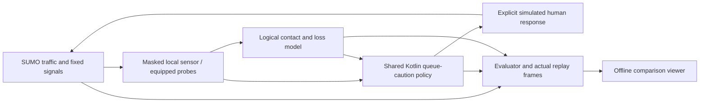

# Junction Lab

A reproducible offline experiment for the junction-flow proposal. It runs the same traffic demand in three modes and replays the exported trajectories side by side:

| Mode | Information allowed | Output |
|---|---|---|
| No advice | Hypothetical local sensing retained for inspection | No warnings or response |
| Local only | A stopped vehicle within the forward sensor range | Queue caution |
| Mesh informed | Local sensing plus fresh, scoped reports from equipped stopped probes | The same queue caution |

The first three-seed result did **not** reduce spillback and slightly increased delay with mesh advice. See [measured results](../../docs/junction-lab-results.md). The replay is an experiment, not an animation of an assumed improvement.

## Run it

Prerequisites: the repository's JDK 17 setup, Python 3.10+, and the pinned SUMO packages. These packages include native SUMO and netconvert binaries on supported platforms; otherwise install SUMO 1.28.0 and put its binaries on PATH. No phone, Android emulator or network service is required.

From the repository root in PowerShell:

```powershell
# Set JAVA_HOME to your installed JDK 17 first.
.\gradlew.bat :core:test :core:junctionPolicyJar
python -m venv tools/junction_lab/.venv
& tools/junction_lab/.venv/Scripts/python.exe -m pip install -r tools/junction_lab/requirements.txt
& tools/junction_lab/.venv/Scripts/python.exe tools/junction_lab/run.py --seeds 7 19 42 --output tools/junction_lab/output/comparison
```

On macOS/Linux use `./gradlew` and `.venv/bin/python`. An explicit `--java /path/to/jdk17/bin/java` overrides JAVA_HOME/PATH. Use `--help` for sensitivity parameters.

Open `tools/junction_lab/output/comparison/report.html` directly. It embeds the actual results and works offline. Select a seed, scrub the shared clock and inspect a vehicle. The separate `viewer.html` accepts a `results.json` file; browser restrictions can prevent automatic JSON loading over `file://`, so use its file picker. The timeline displays recorded samples without inventing intermediate trajectories. Generated output is ignored by Git.

Exports include `results.json`, `summary.csv`, scenario XML and each run's SUMO log. To repackage an existing result after a viewer change without rerunning traffic:

```powershell
& tools/junction_lab/.venv/Scripts/python.exe -c "import sys; sys.path.insert(0, 'tools/junction_lab'); from run import export_viewer; export_viewer('tools/junction_lab/output/comparison')"
```

## What is implemented



`core/.../junction/JunctionPolicy.kt` is Android-free. Its CLI adapter lets Python use exactly that implementation rather than a Python imitation. It enforces freshness, exclusive expiry, directed scope, ahead distance, minimum movement speed, event deduplication, a recipient cooldown and bounded state. It emits a caution, not permission to enter a junction. The existing Android app does not call it yet.

`scenario.py` owns geometry and fixed traffic conditions. `model.py` owns independent deterministic random streams, bounded logical transport and the process bridge. `run.py` connects these adapters, measures outcomes and exports the replay. The [contract](CONTRACT.md) describes the replaceable interfaces. None is a final architecture: future estimators, candidate policies, response models, scenarios and real transport adapters can replace one boundary at a time.

## Disclosed assumptions

- Two junctions, a finite connector, one eastbound lane, one car class and 72 scheduled vehicles. J2 is red from 35 to 95 seconds; advice never controls signals. The default horizon is 180 seconds.
- A hypothetical local sensor detects stopped vehicles within 35 m. Only equipped vehicles stopped on the connector for at least 2 seconds originate mesh reports. Sensing is idealized: no false positives, occlusion or position error in this slice.
- Default penetration and compliance are both 0.6. Compliance is a fixed driver draw. A responding driver adopts a desired-speed cap of 8 m/s for 8 seconds after a 1.5-second delay. SUMO car-following remains active. This is an uncalibrated response model; the app does not actuate vehicles or prescribe that speed.
- Logical contacts use an assumed 85 m range, 0.5-second link delay and 10% independent packet loss. Reports expire after 8 seconds, with three hops, a 4096-message pending bound and 128 entries per node. There is no BLE byte, contention, interference, background-OS or energy model.
- Two optional stationary pedestrian phones forward reports only. They do not represent simulated pedestrians or validate pedestrian safety.
- Policies receive report positions and age, recipient scope and speed. Ground-truth queue extent and fixed signal state are reserved for the evaluator. No queue occupancy estimator, MPC solver, price decomposition, routing optimization or distributed handover protocol is implemented yet.

## Read the metrics correctly

| Metric | Definition and limit |
|---|---|
| `totalDelayS` | Fixed-horizon integral of active speed deficit `max(0,1-v/free_speed)` plus scheduled-but-uninserted vehicle waiting. Vehicle-seconds; unfinished and source-waiting traffic remain counted. Not completed-trip travel time. |
| `spillbackDurationS` | Time stopped-vehicle extent on the connector reaches its 15 m upstream buffer. Not proof of contiguous queues or a blocked junction. |
| `maxQueueExtentM` | Maximum distance from connector end to the rearmost stopped vehicle's front position. Geometry diagnostic, not estimated queue PCU. |
| `maxCorridorStoppedExtentM` | The same stopped extent extended across the straight approach and connector. Reveals upstream congestion hidden by a connector-only measure; still not a contiguous queue or junction-blocking measure. |
| `maxSourceBacklog` | Peak scheduled-but-uninserted count. Includes step quantization of departures; shared across matched modes. |
| `advisoryCount` | Emitted cautions, including repeated recipients after the 12-second cooldown. |
| `meanWarningLeadS` | Time from caution to crossing the historical reported position, sampled at 0.5 seconds. Unobserved crossings are censored. Does not establish that the hazard persisted. |
| `usefulWarnings` | Observed crossing lead at least the assumed response delay. A diagnostic threshold, not measured usefulness or safety. |
| `responsesApplied` | Warnings whose simulated response actually began before the horizon/vehicle departure. `responseAccepted` alone is insufficient. |
| `capActivationsAboveLimit` | Activations when vehicle speed was above the new desired-speed cap. A diagnostic, not a causal estimate of braking caused by advice. `capActiveVehicleSeconds` reports cap duration across vehicles. |
| `meanKinematicLeadS` | Report distance divided by current recipient speed when cautioned. A constant-speed extrapolation, not TTC or observed reaction time. Per-warning `timeToFirstStopS` records a later stop before crossing the report location, otherwise null. |
| `deliveredMessages` | Logical cache admissions. Distinct from an end-to-end receipt or a radio transmission measurement. |
| `expiredMessages` | Forwarding attempts rejected by lifetime or in-flight records discarded at expiry. Ordinary cache expiry is excluded; one event can contribute multiple records. |
| `collisions` | Sum of SUMO colliding-vehicle counts per step; not unique crash events or a safety proof. |
| `conservationErrors` | Failed accounting checks. Scheduled = future + pending insertion + active + arrived; departed = active + arrived. |

Summary ranges are descriptive min/max over the selected seeds, not confidence intervals. Seeds change equipment, compliance and link losses; demand itself stays fixed. No omitted external/source queue can make a congested run look better.

## Verification

```powershell
.\gradlew.bat :core:test :core:junctionPolicyJar :sim-core:test :app:testDebugUnitTest
$env:JUNCTION_SUMO_TESTS='1'
$env:JUNCTION_JAVA=Join-Path $env:JAVA_HOME 'bin/java.exe'
& tools/junction_lab/.venv/Scripts/python.exe -m unittest discover -s tools/junction_lab -p 'test_*.py' -v
```

Without `JUNCTION_SUMO_TESTS=1`, only pure Python tests run and integration tests are explicitly skipped. Requested integration tests fail if the built jar or SUMO is unavailable.

Acceptance checks cover unchanged traffic at zero compliance despite delivered cautions; unchanged traffic and no cautions at zero penetration; mesh/local identity with 100% packet loss; retained source backlog; no teleports or lost vehicles; deterministic replay; actual response-induced differences; expired and disappearing contacts; bounded queues; and safe standalone JSON embedding. Kotlin tests cover malformed input, versioned CLI behavior, clock reversal, boundaries, cooldown, deduplication and state pressure.

The next useful extension is a capacity-aware candidate policy that can abstain when a slowdown offers no benefit, compared against this warning-only baseline. Add each capability with a matched experiment before connecting it to phone output. Mixed road users, uncertain sensing, legal conflict geometry, RF congestion and calibrated human behavior remain separate validation work.

The default case is heavily queued. A lighter comparison changes the exogenous conditions identically for all modes:

```powershell
& tools/junction_lab/.venv/Scripts/python.exe tools/junction_lab/run.py --vehicles 30 --departure-interval 3 --red-start 35 --red-end 55 --output tools/junction_lab/output/lighter-demand
```

Signals switch directly between fixed red and green in this simplified test; yellow transitions and uncertain signal timing must be modeled before drawing conclusions about real responses near phase changes. Local reports receive a new ID per sensor sample; repeated-caution suppression mainly comes from recipient cooldown. The mesh is a flooding baseline with potentially many duplicate receptions; its bounded memory does not establish sustainable radio load.

Sources for the simulator interface: [SUMO installation](https://sumo.dlr.de/docs/Installing/index.html), [TraCI vehicle state changes](https://sumo.dlr.de/docs/TraCI/Change_Vehicle_State.html). Broader primary research and corrected mathematics remain in [the junction specification](../../docs/junction-flow-spec.md) and [evidence matrix](../../docs/research/traffic-evidence.md).
